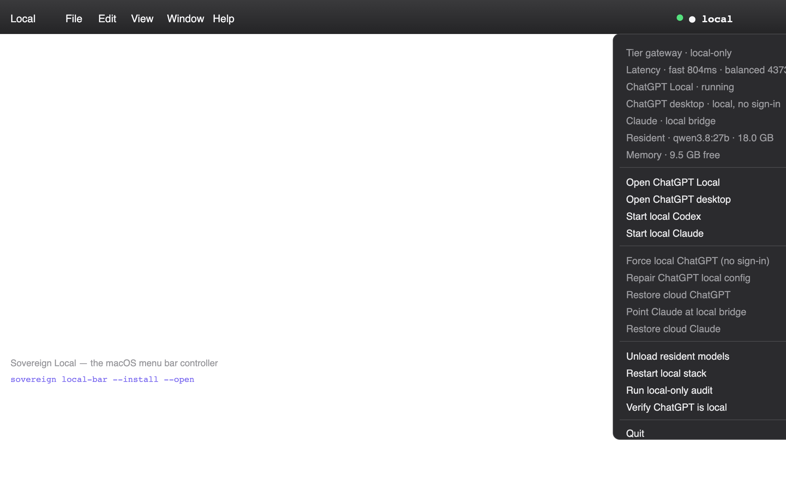

<p align="center"></p>

<!-- zerodevllc-theme -->
[](https://ZeroDevLLC.com)
[](https://ZeroDevLLC.com)

# Sovereign Code

**A terminal-first, local-first AI coding console for Apple Silicon.**

[](https://github.com/ZeroXSHDW/sovereign-code/actions/workflows/ci.yml)
[](https://sovereign.zerodevllc.eu)
   

Sovereign Code is a portable Python/Textual replacement for the Swift menu-bar
approach of the earlier Local Bar projects: one terminal-first console that
routes every coding request to the right local model, and lets Codex, Claude
Code, OpenCode, Qwen Code and Continue work as real agents on this Mac. A
live read-only monitor shows the skill bank, which project is using a model,
which models are resident, and what the stack is doing — it never sends a
prompt or holds a model just to watch.

Chat is an explicit opt-in (`sovereign chat`), because every turn keeps a model
resident for its `keep_alive` window and that is RAM the monitor exists to
protect. Specialised models — legal, forensics, finance, security — are pulled
when you need them (`sovereign pull`, `sovereign hf import`) and selected for
the clients in one command (`sovereign model-use`).

Nothing leaves the Mac by default. Ollama and every gateway bind to
`127.0.0.1`, and every local alias stays local. Frontier models served by
Ollama Cloud are available as an explicit opt-in (`sovereign cloud`); the router
never selects one on its own.

## Screenshots


The terminal configuration as a 3D stack:


The macOS menu bar controller (`sovereign local-bar`), with live gateway, latency,
resident-model and local/cloud status at a glance:



(`docs/assets/social-preview.png` is the 2400×1260 image — a 2× 1200×630 card —
to set as the repository's social preview.)

## Highlights

- **Local by default** — Ollama and the gateways bind to loopback; no account,
  no telemetry, and the router never picks a cloud model on its own.
- **Tier gateway** — an OpenAI-compatible endpoint on `:4010` (plus an
  Anthropic bridge on `:4001`) routes each request to `fast`, `balanced`,
  `deep`, or `ultra`, with real streamed tool calls for Codex, Claude Code,
  OpenCode, Qwen, and Continue. An optional MLX server joins the same gateway
  on Apple Silicon.
- **Local coding agents** — Codex, Claude Code, OpenCode, Qwen Code, Continue,
  and the Codex side of ChatGPT desktop run on-Mac; `--cloud` is the explicit
  escape hatch. `sovereign verify --clients` proves a real turn through each.
- **22k skills** — route, lint, verify, and install skill packs into
  every client, with project-level `AGENTS.md` / `CLAUDE.md` / `QWEN.md` indexes.
- **Task packs** — pentest, redteam, blueteam, soc, threatintel, vulnerability,
  risk, vendor, legal, compliance, forensics, and finance, each with guardrails,
  steps, and deliverables.
- **Browser, PDF, and Hugging Face** — a policy-checked Chromium operator,
  local OCR/vision for documents, and Hub search/import for models and datasets.
- **24/7 coding loop** — opt-in, gated by the project's own checks, and paused
  by a dirty tree or repeated failure instead of spinning.

## New in 0.6.0

- **`sovereign model-use`** selects an installed model for OpenCode, Codex and
  Claude Code in one command — pull a specialist model (`sovereign pull` or
  `sovereign hf import`) and `model-use` wires it into all three clients.
- **Specialist task packs and domains**: red/blue/purple team, SOC, threat
  intel, malware, cloud and app security alongside legal, forensics and
  finance; `run_pack` and `domain=` route a task to the right skill and model.
- **MLX live-verified on Apple Silicon**: `sovereign mlx start` serves a
  supervised model with a 0.6B speculative draft and 8-bit KV cache
  (~0.45 s warm reply, 2.8 s full answer); `sovereign run` now routes MLX tags
  to the mlx-lm server.
- **Browser and full computer control verified end-to-end**, with the policy
  guard, secret refusal, confirmation gates, and the destructive-command
  deny-list.
- **Coverage floor 53%, 1000+ tests**, `pip-audit` clean, every dependency at
  its latest release.

See the [changelog](CHANGELOG.md) for the full list.

<details>
<summary><strong>Contents</strong></summary>

- [Screenshots](#screenshots)
- [New in 0.6.0](#new-in-060)
- [Quick start](#quick-start)
- [Task packs](#task-packs-pentest-vulnerability-risk-vendor-legal-compliance-forensics-finance)
- [Skills](#skills-find-check-install)
- [Models and offline stacks](#models-24-gb-m5-pro)
- [Tier gateway](#tier-gateway-fast-models-for-small-work-big-models-for-hard-work)
- [Local coding clients](#local-coding-clients)
- [MCP](#mcp-for-chatgpt-claude-desktop-codex-claude-code-opencode-qwen)
- [Hugging Face Hub](#hugging-face-hub)
- [Commands](#commands)
- [Browser operator](#browser-operator)
- [PDF, OCR, and document imaging](#pdf-ocr-and-document-imaging)
- [Skills, memory, and multi-model](#skills-memory-and-multi-model)
- [Semantic code search](#semantic-code-search)
- [Login terminal](#login-terminal)
- [Autostart](#autostart-keep-alive-and-reboot)
- [Architecture](#architecture)
- [Documentation](#documentation)
- [Troubleshooting](#troubleshooting)
- [Updating](#updating)
- [Cleanup and uninstall](#cleanup-and-uninstall)
- [FAQ](#faq)
- [Development](#development)
- [Security](#security)
- [License](#license)

</details>

## Quick start

**Requirements:** an Apple Silicon Mac (M1 or newer), macOS 14+, Python 3.11+,
and [Ollama](https://ollama.com). Optional extras: Chromium/Playwright for the
browser operator, and Poppler + Tesseract for PDF/OCR.

```sh
git clone https://github.com/ZeroXSHDW/sovereign-code
cd sovereign-code
./scripts/bootstrap.sh           # venv, install, PATH, clients, login agent
sovereign                       # open the dashboard now
```

The script uses the checkout it lives in, so it does not have to be under
`~/Documents`. The first run uses
`~/Documents/local-ai/config/sovereign/config.toml` and
`~/Documents/local-ai/data/` (sessions and logs). Bootstrap already runs
`sovereign install-clients`; re-run it after installing a new client.

Verify the install and pull a starter stack:

```sh
sovereign doctor                 # paths, ports, models, aliases, concrete fixes
sovereign doctor --fix           # apply the safe fixes automatically
sovereign setup-stack lean       # ~8 GB starter; use `capable` for the best coder
sovereign verify --clients       # real turn through Codex, Claude Code, OpenCode
sovereign status                 # one-shot stack status
```

For the browser operator, download the browser once:
`playwright install chromium`. For PDF/OCR: `brew install poppler tesseract`.

### Let a coding agent build the project

The repo carries its own agent brief. Open the folder in OpenCode or ChatGPT
(Codex) and the agent loads, without extra steps:

- `AGENTS.md`: setup, checks, layout, conventions, and the curated skill index.
- `opencode.json`: the `sovereign` MCP server (`list_skills`, `get_skill`,
  `best_model`, `run_checks`, …), the instructions file, and edit/bash permission.
- `docs/ROADMAP.md`: prioritised work. Ask the agent "what next" to start there.

### Task packs: pentest, redteam, blueteam, soc, threatintel, vulnerability, risk, vendor, legal, compliance, forensics, finance

A pack is everything an agent needs to work a whole project in one category:
skills to load, Hugging Face search queries, guardrails, steps, and deliverables.

```sh
sovereign pack list
sovereign pack show pentest                     # guardrails, steps, matching skills
sovereign pack models forensics                 # installed model + Hugging Face GGUF hits
sovereign pack brief pentest --brief ~/src/app/AGENTS.md   # writes the brief and SCOPE.md
```

`pack brief` writes a managed block into the project's `AGENTS.md`; OpenCode and
ChatGPT read it when the folder opens. The sovereign MCP server also exposes
`list_packs` and `pack_profile`. Hugging Face hits are search results, not
verified models: check the licence, then `sovereign hf import <repo>` and
`sovereign verify`. Pentest work stops unless `SCOPE.md` lists the targets.

Run the checks the agent should pass before it reports done: `make check`.
`make quality` adds the dependency audit (pip-audit), and `make bench` runs
the model benchmark. `CONSTRAINTS.md` records the exact bar.

### Make any folder agent-ready

```sh
sovereign project init ~/src/app                  # detect stack and checks, write AGENTS.md + opencode.json
sovereign project init ~/src/app --pack pentest   # also adds the pack's guardrails and SCOPE.md
```

`project init` never overwrites an existing brief or config without `--force`,
and `--dry-run` prints what it would write. The generated `AGENTS.md` names the
project's own test command, so the agent can verify itself.

Inside that folder the agent gets three navigation tools over MCP:

| Tool | What it answers |
| --- | --- |
| `repo_map` | languages, files, and every class/function with line numbers |
| `repo_search` | `path:line` matches for a term or regex, code files first |
| `repo_read` | numbered lines around a hit, without the rest of the file |
| `repo_write` | create or replace one file, atomically, with an optional sha256 guard |
| `repo_edit` | replace one exact string; refuses an ambiguous match; `dry_run` shows the diff |
| `repo_patch` | apply a unified diff to one file; every hunk must match or nothing is written |

The 22k-file skill library is Markdown, so it is ranked after code: without
that rule a search on this repo never reached `src/`.

Writes are fenced like reads: inside the workspace, credential files refused,
2 MB per write, atomic replacement, and an existing file is not overwritten
unless the caller passes `overwrite` or the `expected_sha256` it read. They work
with `SOVEREIGN_MCP_COMPUTER=0`, so editing does not require full computer
control.

### Skills: find, check, install

```sh
sovereign skills route "harden a kubernetes cluster"   # cards: name, category, tokens, risk
sovereign skills lint                                  # scan curated skills for risky instructions
sovereign skills lint --query terraform --limit 20     # scan library matches
sovereign pack install forensics --target opencode      # install a pack's skills as SKILL.md
```

`route` ranks by content terms, weighting rare words over generic ones, and keeps
the task's category coherent (a forensics task does not return image-generation
skills). Cards are cheap: the agent loads a body only after a card looks right.

`lint` reports pipe-to-shell, root deletes, disk writes, prompt injection, `sudo`,
credential paths and hidden characters, with line numbers. It never edits a
skill: security skills legitimately quote attacks, so the warning tells the
agent to treat the commands as untrusted text.

`get_skill` and `load_skills` carry the same warning, and `load_skills` enforces
a token budget (default 6000) so several large skills cannot swallow a 16k
window. A 192 KB skill costs about 48k tokens; the median is 5.4 KB.

### Unrestricted models

The defaults keep prompts on the Mac. To lift the limits deliberately:

```sh
sovereign pull <any-ollama-tag>             # any library tag, or
sovereign hf import <owner/repo>            # any Hugging Face GGUF
# config.toml: max_context = 131072         # larger windows when memory allows
SOVEREIGN_LOCAL_ONLY=0 sovereign router --restart   # allow provider routes via the gateway
sovereign cloud --set-key openrouter        # prompts leave the Mac on provider routes
```

Everything the system owns lives in `~/Documents/local-ai`:

```text
~/Documents/local-ai/
├── gateway/     LiteLLM config, venv, supervisor, logs
├── bin/         qwen-local, codex-local, claude-local
├── config/      sovereign/ and codex/ profiles
├── data/        sessions and logs
├── models/      Ollama weights (34 GB; ~/.ollama/models symlinks here)
├── qwen/        Qwen Code state (~/.qwen symlinks here)
└── legacy/      archived pre-migration ai-stack
```

### Apple Silicon MLX models

Ollama is not the only local engine. Apple's `mlx-lm` server runs quantized
models natively on Metal and speaks the same OpenAI API, so every client can
use it through the same aliases:

```sh
python3.13 -m venv ~/Documents/local-ai/mlx-venv
~/Documents/local-ai/mlx-venv/bin/python -m pip install mlx mlx-lm
sovereign mlx models                # catalog, downloaded state, HF repository
sovereign mlx pull --model mlx-qwen3-14b-4bit   # weights + 0.6B draft
sovereign mlx start --model mlx-qwen3-4b-4bit
sovereign mlx status                # online, supervised PID, draft, downloaded tags
sovereign mlx stop
```

`sovereign mlx start` uses `~/Documents/local-ai/mlx-venv` automatically
(or `SOVEREIGN_MLX_PYTHON`), records the model/port/PID in
`data/mlx-server.json`, and the guardian restarts that exact model if it
crashes. Starting with no `--model` picks the strongest downloaded model.
Qwen3 models automatically use **speculative decoding** with the 0.6B draft
model when it is downloaded, plus an 8-bit KV cache. Measured on the 4B model:
**69 tok/s without a draft, about 125 tok/s with one** (about 1.8x). Disable it
with `--draft off` or force it with `--draft mlx-community/Qwen3-0.6B-4bit`.
Four draft tokens per step beat both two (110-123 tok/s) and eight (~90 tok/s).
`sovereign mlx start --kv-bits 0` trades the quantized cache for mlx-lm's
batched decode: four simultaneous short completions finish in 0.95 s instead of
1.26 s. The memory-saving quantized cache stays the default. Weights downloaded by `mlx-lm` into the standard Hugging Face hub
cache are detected as well as the visible `models/huggingface` folder. Qwen3
models start with thinking disabled so coding clients receive answer content
and tool calls instead of a hidden reasoning pass.

The tier gateway exposes `mlx`, `mlx-code`, `mlx-balanced`, `mlx-fast`, and
`mlx-chat`, plus every downloaded MLX tag in `/v1/models`. A warm 4B MLX
model also serves the `fast` tier automatically, so autocomplete does not pay
for a cold Ollama load. Run
`sovereign gateway-config --apply` after upgrading to merge the MLX aliases
into the live hand-curated LiteLLM `config.yaml` (with a timestamped backup)
without disturbing existing aliases or fallbacks. If the MLX server is
down the gateway returns an explicit `mlx_offline` error with the start command
instead of falling back silently. `sovereign install-clients` adds:
- an **MLX provider** (`http://127.0.0.1:8081/v1`) to OpenCode,
- Continue chat/edit/apply models and a 4B autocomplete model,
- `local-mlx-*` aliases to the LiteLLM model list,
- MLX routes to the Codex/ChatGPT model catalog,
- a **Sovereign Claude** Continue entry that points at the local Anthropic
  bridge (`http://127.0.0.1:4001`), so Continue's Claude chat/edit/apply path
  runs on the local model picker.

### Local embeddings and codebase indexing

`/v1/embeddings` is served by the tier gateway and answered by
`nomic-embed-text` on this Mac, so Continue's `@codebase` index and any
OpenAI-compatible RAG tool stay fully local:

```sh
ollama pull nomic-embed-text
curl -s http://127.0.0.1:4010/v1/embeddings \
  -d '{"model":"local-embed","input":["def add(a,b): return a+b"]}'
```

`local-embed` is the stable alias (768-dim vectors). A request's whole list is
embedded in one Ollama call (64 new chunks took 0.28 s instead of 21.7 s
one-by-one), and identical strings are memoized in-process, so re-indexing
unchanged files costs microseconds instead of a transformer pass.
`sovereign index` also reuses stored vectors by text fingerprint: a rebuild of
an unchanged tree makes no model calls at all. `sovereign install-clients` adds the embed model to
Continue and to the LiteLLM model list; `sovereign doctor` reports it.

### Speed notes

- **MLX prefix reuse is real and measured.** With a stable system prompt, a
  second turn prefills 849 cached tokens and finishes in 0.16 s where the cold
  turn took 1.61 s (about 10x). The gateway records `cached_tokens` per request
  and `/health` reports `prefix_cache_tokens`.
- **Identical prompts are generated once.** Concurrent duplicate non-stream
  requests share one generation through a per-key lock, and the response cache
  answers later repeats in about 1 ms. Streamed answers are cached too and
  replayed as SSE, so a repeat costs milliseconds instead of a generation
  (measured: 0.82 s → 0.00 s on MLX, 3.23 s → 0.01 s on Ollama).
- `sovereign bench` includes `mlx-fast` and `mlx-code` automatically whenever
  the MLX server is running.

### Monitor keys

| Key | Action |
| --- | --- |
| `F2` | suspend the monitor and open Qwen Code in your workspace (`~/Documents`) |
| `F4` | open the local ChatGPT / Codex profile in your workspace |
| `F5` / `r` | refresh the live report now |
| `F6` | open Claude Code against the local gateway |
| `F9` / `f` | unload every resident model (free RAM) |
| `p` | pause or resume the 5-second refresh |
| `y` | copy the current snapshot to the clipboard |
| `?` | open the help overlay |
| `Ctrl+Q` | quit |

The monitor also shows a health verdict with the reasons behind it, five-minute
sparklines for RAM/load/resident GPU memory, model inventory, and aggregate
gateway throughput (requests, tokens, p50/p95 latency, tool calls, and streams).
The login monitor is read-only: no chat prompt, no slash commands, no model
load, and no background guardian tick. Use `sovereign chat` when you want a
conversation and `sovereign code` when you want the coding agent.

For scripts and screenshots:

```sh
sovereign monitor --json            # one machine-readable report
sovereign monitor --demo            # deterministic UI for screenshots/tests
```

`workspace` lives in `~/Documents/local-ai/config/sovereign/config.toml` and defaults to
`~/Documents`; `sovereign code /path/to/repo` overrides it for one session.

## Models (24 GB M5 Pro)

### Installed / recommended

| Model | Role | Notes |
| --- | --- | --- |
| `qwen3.8:27b` | **primary** — code, agent, reason, chat, vision | 18 GB; native vision; 256k native window, **16k** verified at 100% GPU on 24 GB |
| `qwen3-coder:30b` | fast coder (`local-code-fast`) | 19 GB MoE, ~3B active; 32k verified with q8 KV |
| `glm-4.7-flash` | alternate reasoner / thinking | 19 GB; 32k with `think:false`; needs the machine to itself |
| `gpt-oss:20b` | fastest strong tool caller | 13 GB; 16k |
| `qwen2.5-coder:14b` | dense fallback for every alias | 9.0 GB; 32k with q8 KV |
| `gemma4:12b` | independent reviewer (`local-review`) | 7.7 GB; a *different family* from the Qwen implementer, on purpose |
| `qwen3.5:9b` | Claude Code / balanced tier | 7.6 GB; 64k, which Claude Code's tool prompt needs |
| `qwen3.5:4b` | fast tier | 4.0 GB; 8k |
| `nomic-embed-text` | embeddings | 0.3 GB |

`glm4`, `qwen2.5-coder:7b`, and `deepseek-r1:8b` are no longer in the daily
alias set — the 27B superseded them for general work — but they remain in the
catalog, and the two smaller models also appear in the `lean`/`balanced`/`max`
presets. Run one model at a time:
`OLLAMA_MAX_LOADED_MODELS=1` is set in the launch agent, because keeping a
second 18–20 GB model resident only produced half-spilled runners
(13%/87% CPU/GPU) and a reload on every task switch.

### Downloadable (any tag works with `sovereign pull` / `sovereign run`)

`OllamaClient` talks to Ollama directly, so **any** Ollama library tag can be
downloaded and run — not just the curated ones below. Use
`sovereign model-info <tag>` to check parameter size, quantization, family, and
context length before you pull, and `sovereign models --remote [query]` to
browse the curated catalog.

| Model | Rough size | Notes |
| --- | --- | --- |
| `qwen2.5-coder:1.5b` | ~0.9 GB | tiny coder; fast, low RAM |
| `qwen2.5-coder:3b` | ~1.9 GB | small coder; quick edits and iteration |
| `qwen2.5-coder:7b` | ~4.7 GB | solid coder |
| `qwen2.5-coder:14b` | ~9.0 GB | best coder that fits 24 GB |
| `qwen2.5-coder:32b` | ~20 GB | stronger coder; tight on 24 GB |
| `deepseek-coder-v2:16b` | ~9 GB | strong coding model |
| `deepseek-r1:7b` | ~4.4 GB | reasoning with visible chain-of-thought |
| `deepseek-r1:14b` | ~9 GB | reasoning with visible chain-of-thought |
| `deepseek-r1:32b` | ~20 GB | strong reasoning; tight on 24 GB |
| `qwen3:4b` | ~2.3 GB | current-gen general model |
| `qwen3:8b` | ~4.9 GB | current-gen general model with reasoning |
| `qwen3:14b` | ~9 GB | current-gen general model with reasoning |
| `llama3.2:3b` | ~2.0 GB | tiny fast general model |
| `llama3.1:8b` | ~4.9 GB | reasoning fallback with long context |
| `gemma3:12b` | ~7.7 GB | general model with strong reasoning |
| `phi4:14b` | ~9 GB | small reasoning model |
| `codestral:22b` | ~13 GB | Mistral coding model; tight on 24 GB |
| `qwen3.8:27b` | ~18 GB | **primary** local coder/agent, native vision; 256k native ctx, tight on 24 GB |
| `nomic-embed-text` | ~0.3 GB | embeddings for semantic search |

> **Qwen3.8-Flash-Next is not on this list, on purpose.** It is the 125B-A6B
> datacenter sibling of the 27B: the *smallest* published artifact is 105 GB
> (`qwen3.8-flash-next:125b-a6b-nvfp4`, or `:125b-mlx`), the GGUF quants start at
> 120 GB, and OCI requires `H100_X8`/`H200_X4` to serve it. On 24 GB of unified
> memory it can only page off the SSD, so it would be the slowest option here,
> not the fastest. It is deliberately absent from `REMOTE_CATALOG`, so
> `sovereign models --remote` will not offer it — check
> [ollama.com/library/qwen3.8-flash-next](https://ollama.com/library/qwen3.8-flash-next)
> for sizes, because a bare `ollama pull qwen3.8-flash-next` starts a ≥105 GB
> download.

### Frontier cloud models (opt-in — prompts leave the Mac)

These are served by **Ollama Cloud** or a **provider key** (OpenRouter, DeepSeek,
Z.ai, Moonshot, Alibaba), not downloaded. `sovereign cloud` shows the mapping,
the route each alias will use, and readiness. `sovereign cloud --enable` flips
the two switches that disable Ollama Cloud (`~/.ollama/server.json` and
`OLLAMA_NO_CLOUD`), updates the login agent and the sourced shell profile, and
restarts Ollama.

| Requested | Ollama tag | Context | What it is |
| --- | --- | --- | --- |
| Kimi K3 | `kimi-k3:cloud` | 1M | Moonshot, native multimodal agent, 2.8T |
| DeepSeek Flash V4.1 | `deepseek-v4.1-flash:cloud` | 1M | DeepSeek's current fast coding model |
| DeepSeek Flash V4 Pro | `deepseek-v4-pro:cloud` | 1M | 1.6T MoE, frontier reasoning |
| DeepSeek V4 Flash | `deepseek-v4.1-flash:cloud` | 1M | exact V4 Flash with a provider key; V4.1 Flash over Ollama (tag retired 2026-08-27) |
| GLM 5.3 FL | `glm-5.3-flash:cloud` | 1M | Z.ai 320B MoE / 18B active, multimodal |
| GLM 5.2 | `glm-5.2:cloud` | ~976k | Z.ai previous flagship |
| QWEN 3.8 | `qwen3.8:27b` | 256k | **local** 18 GB download; not cloud; primary for code/agent/reason |
| Kimi K2.6 | `kimi-k2.6:cloud` | 256k | Moonshot multimodal agent |

```sh
sovereign cloud                     # status, mapping, and what is ready
sovereign cloud --enable            # enable Ollama Cloud + restart (persists)
ollama signin                       # one-time account login
sovereign cloud --install-aliases   # write cloud-* aliases into the gateway
sovereign pull kimi-k3:cloud        # register a cloud model (no weights)
sovereign run kimi-k3:cloud "…"     # stream a prompt from it
sovereign pull qwen3.8:27b          # the one local model in the list (~18 GB)
```

Gateway aliases (after `--install-aliases` and a gateway restart):
`cloud-kimi-k3`, `cloud-kimi-k2.6`, `cloud-deepseek-v4.1-flash`,
`cloud-deepseek-v4-flash`, `cloud-deepseek-v4-pro`, `cloud-glm-5.3`,
`cloud-glm-5.3-flash`, `cloud-glm-5.2`, `cloud-qwen3.8`, `local-qwen3.8`, plus
the role aliases `local-cloud` and `local-cloud-fast`. Use them anywhere an
alias is accepted:

```sh
sovereign consult "review this design" --models cloud-kimi-k3,cloud-glm-5.3
sovereign bench --models cloud-kimi-k3,cloud-deepseek-v4-pro
sovereign pipeline "…" --plan-model cloud-glm-5.3 --review-model cloud-kimi-k3
```

**Plan requirement.** Ollama Cloud needs an account, and these frontier models
need an **Ollama Pro** plan. The app wires everything correctly, but the
subscription is on the account: on a Free plan every one of them returns HTTP
402 with an upgrade link, which `sovereign cloud --probe` reports as
`needs an Ollama Pro plan`. Qwen 3.8 is the exception because it runs locally.

### Use a provider key instead (no Ollama Pro needed)

One **OpenRouter** key covers all eight models. Direct DeepSeek, Z.ai, Moonshot,
and Alibaba keys also work and are preferred when present (fewer hops, usually
cheaper):

| Provider | Env var | Models |
| --- | --- | --- |
| OpenRouter | `OPENROUTER_API_KEY` | all eight, including exact `deepseek/deepseek-v4-flash` |
| DeepSeek | `DEEPSEEK_API_KEY` | V4.1 Flash, V4 Pro, V4 Flash |
| Z.ai | `ZAI_API_KEY` (or `ZHIPUAI_API_KEY`) | GLM 5.3, 5.3 Flash, 5.2 |
| Moonshot | `MOONSHOT_API_KEY` (or `KIMI_API_KEY`) | Kimi K3, K2.6 |
| Alibaba | `DASHSCOPE_API_KEY` (or `QWEN_API_KEY`) | Qwen 3.8 Max (cloud fallback) |

```sh
sovereign cloud --set-key openrouter     # prompts hidden; writes cloud.env 0600
sovereign run cloud-kimi-k3 "…"          # direct provider call, works immediately
sovereign cloud --install-aliases        # cloud-* now route through OpenRouter
sovereign gateway --restart
sovereign cloud --probe                  # one tiny completion through the chosen route
```

`sovereign run` talks to the provider directly for a provider route, so it
needs no gateway restart. `consult`, `bench`, `summarize`, `pipeline`, and the
client tools use the gateway aliases, which do need `--install-aliases` and a
restart.

Routing is `auto` by default: a configured direct provider key, then OpenRouter,
then Ollama Cloud. Force a route with `--route openrouter` (or `ollama`,
`deepseek`, `zai`, `moonshot`, `dashscope`). `local-qwen3.8` is always local;
`cloud-qwen3.8` uses a provider when one is configured. Keys live in
`~/Documents/local-ai/gateway/cloud.env` (mode 0600), which the gateway
supervisor sources; `sovereign cloud` only shows a masked value.

**Privacy.** A `:cloud` tag sends the prompt, system message, and attached
context to ollama.com; a provider route sends them to that provider (OpenRouter
or the direct vendor). Local aliases and the local router are unchanged.

Every `pull` prints an estimated size and warns when free disk is low, and
`sovereign rm <tag>` reclaims space.

### Offline model stacks

These are rough installed-size totals for a 24 GB Mac; models run one or two
at a time (Ollama swaps automatically). The stacks are defined in
`src/sovereign_code/models.py`, so `sovereign pull-stack --help` always lists
the current set.

| Stack | Models | Approx. total | Note |
| --- | --- | --- | --- |
| `lean` | qwen3.5:4b, qwen2.5-coder:7b, nomic-embed-text | ~8 GB | fast chat + a FIM coder + embeddings; leaves most RAM free |
| `balanced` | gpt-oss:20b, qwen3.5:9b, nomic-embed-text | ~21 GB | strong tool-caller + fast chat; still fits beside the OS |
| `capable` | qwen3-coder:30b, qwen3.5:9b, qwen3.5:4b, nomic-embed-text | ~33 GB | daily stack: best coder, fast chat, tiny helper; the 30B wants the machine to itself |
| `max` | qwen3-coder:30b, glm-4.7-flash, gpt-oss:20b, deepseek-r1:8b | ~51 GB | every model worth keeping; the 18–19 GB models run strictly one at a time |

Pull a stack one model at a time, or pull a whole stack in one command:

```sh
sovereign pull-stack lean       # ~8 GB: fast chat, coder, embeddings
sovereign pull-stack balanced   # ~21 GB: strong tool-caller + fast chat
sovereign pull-stack capable    # ~33 GB: best coder + fast chat + helper
sovereign pull-stack max        # ~51 GB: full set (pull one at a time)
sovereign setup-stack capable   # pull stack, then verify gateway aliases
sovereign pull-stack cloud      # register the 7 cloud tags (no download)
```

The router picks the best **installed** model for the task, then chooses the
largest context that fits in ~85% of free memory. Agentic coding prefers a
model that is verified to call tools (`gemma4:12b`, then `qwen3.5:4b`) rather
than a code model that only chats. The 14B coder reaches 32,768 tokens because
Ollama runs with flash attention and a q8_0 KV cache; without those settings its
verified ceiling is 20,480. The context choices are
`32768, 24576, 20480, 16384, 8192, 4096, 2048`. `sovereign free` evicts resident
models before a turn so a 4B model is not squeezed into a 2k context by a
resident 12B. If the 14B coder is missing it falls back to 7B and says so;
`sovereign pull-recommended` installs it.

## Tier gateway: fast models for small work, big models for hard work

`sovereign router` runs an OpenAI-compatible gateway on `127.0.0.1:4010` in front
of LiteLLM (4000) and Ollama. It classifies each request and sends it to a tier:

| Tier | Model | Context | Used for |
| --- | --- | --- | --- |
| `fast` | `qwen3.5:4b` | 8k | short questions, simple edits, one-line answers |
| `balanced` | `qwen3.5:9b` | 65k | tool use, multi-turn work, medium prompts |
| `deep` | `qwen3-coder:30b` (code) · `glm-4.7-flash` (reasoning) | 32k | code, analysis, long/complex prompts |
| `ultra` | `qwen3.8:27b` | 16k | hardest reasoning, only when explicitly requested |
| `best` / `auto` | quality-first / latency-first aliases | 32k | 30B coder for code, GLM for reasoning |

Benchmarked on this Mac with the same coding prompt: `qwen3-coder:30b` **12.7 s**,
`glm-4.7-flash` **13.4 s**, `qwen3.8:27b` **45.1 s**. That is why `deep` routes
coding to the 30B MoE and reasoning to GLM, and the dense 27B is now the explicit
`ultra` tier rather than the default for every hard request.

```sh
sovereign router --start        # background gateway
sovereign router --status       # tiers, current models, upstream
sovereign router --stats        # recent request count and average latency
sovereign status                # shows tier gateway online/offline
```

Clients ask for `best` (quality-first) or `auto` (latency-first); named aliases still work. The gateway streams correct
OpenAI tool calls directly from Ollama (LiteLLM's streamed Ollama translation
returns them as text), so OpenCode, Continue, and Qwen can execute tools through
the tier gateway. It also:

- loads no model at startup: RAM is spent only on a request that needs it
  (`sovereign warm` still preloads deliberately);
- keeps **one model resident** at a time, evicting the other before a tier
  switch (two 18 GB models panic the Metal allocator on a 24 GB Mac);
- re-loads a model if its resident context is smaller than the tier requires;
- caches short, deterministic, tool-free responses for 10 minutes (`x-sovereign-cached: 1`);
- truncates huge tool outputs, compacts old turns while keeping the task anchor, and
  tells a model to stop when the same tool call repeats three times — so multi-hour
  sessions do not silently overflow the context or loop forever;
- exposes `x-sovereign-tier`, `x-sovereign-model`, and `x-sovereign-reason` headers;
- writes per-request latency to `~/Documents/local-ai/data/logs/tiers.jsonl`.

Measured on this M5 Pro / 24 GB: a cached short answer returned in ~0.1 s, a warm
9B agent turn took ~7–9 s, a 30B code turn took ~12–28 s depending on prompt size,
and the 27B ultra answer took ~21 s once warm. The first request after a tier
switch pays the model load.

**Local-only is enforced by default.** Cloud aliases and provider routes return
HTTP 403 instead of silently leaving the Mac. To allow them deliberately:

```sh
SOVEREIGN_LOCAL_ONLY=0 sovereign router --restart
```

`sovereign local --strict` verifies the gateway is in local-only mode.

Explicit models bypass classification: `local-fast`, `local-chat`, `local-code`,
`local-agent`, `local-claude`, `local-glm`, `local-vision`, … are mapped to their
configured models; `cloud-*` and other upstream aliases are **blocked** in the
default local-only mode. Start the gateway with `SOVEREIGN_LOCAL_ONLY=0` to allow
them to proxy through LiteLLM.

### Client defaults with the tier gateway

- OpenCode: `sovereign/auto`, small model `sovereign/balanced` (avoids a model
  swap on every turn), plus the `local/` provider; `openrouter/` is opt-in.
- Continue: `Sovereign Best`, `Sovereign Auto`, `Sovereign Deep`, and
  `Sovereign Ultra` OpenAI-compatible models.
- Qwen Code: default `best` in its OpenAI provider list.
- ChatGPT (Codex app): `model = "best"` in `~/.codex/config.toml`, pinned to the
  tier gateway's **Responses API** with no OpenAI sign-in.
- Claude Code: the bridge → tier gateway. The default turn follows the quality
  route (`best`); the picker slots are mapped to local routes by the bridge:
  Sonnet → `deep` (30B coder), Opus → `ultra` (27B), Haiku → `fast` (4B). The
  slots carry the model ids Claude Code knows, so it never complains about a
  name it does not recognise.
- Codex: the local profile points at the tier gateway's **Responses API**
  (`/v1/responses`), so it gets the same fast/balanced/deep routing and real
  tool calls. `--cloud` switches to the ChatGPT subscription.
- `sovereign env`: `OPENAI_BASE_URL` is the tier gateway and `OPENAI_MODEL=best`.

### The model catalog: one list, both clients

Both gateways serve the same model list, built from the routing tables and the
models Ollama has installed:

```sh
curl -s http://127.0.0.1:4010/v1/models   # the tier gateway (ChatGPT, Codex, OpenCode)
curl -s http://127.0.0.1:4001/v1/models   # the Anthropic bridge (Claude)
```

The list holds the tiers (`fast`, `balanced`, `deep`, `ultra`), the quality
routes (`auto`, `best`), the local aliases (`local-claude`, `local-glm`,
`local-review`, …) and every installed local model by name. Anything in it can
be asked for: a client that names `qwen3-coder:30b` gets exactly that model.
Cloud and embedding models are not in the list, because the local-only gateway
refuses them and they cannot answer a chat turn.

`sovereign doctor` checks the models every client config points at against that
list, so a config that names a model the gateway cannot route is reported
instead of failing at the first prompt. A request that does not fit the model
the route picked is answered by the 64k 9B instead of being truncated.


### Gateway wiring for LiteLLM aliases

The `*-local` wrappers from `sovereign install-clients` call `sovereign launch`,
which picks the tier gateway for Codex/ChatGPT, the Anthropic bridge for Claude
Code, and the configured local provider for each other client. Separately,
`sovereign env` exports the loopback endpoints, and the LiteLLM gateway on
`:4000` still serves the named aliases (`local-chat`, `local-code`,
`local-agent`, `local-claude`, `local-reasoning`, `local-reasoning-deep`,
`local-chat-qwen3`, `local-fast`, `local-vision`, …). Those aliases are mapped
to Ollama models in `~/Documents/local-ai/gateway/config.yaml`. Use these
commands to make sure an alias you rely on points at a model you have
downloaded:

```sh
sovereign gateway-aliases        # alias → model → installed? → size
sovereign gateway-aliases        # exit code 1 if any alias points to a missing model
sovereign pull qwen2.5-coder:14b gemma4:12b   # pull multiple at once
sovereign setup-stack capable    # pull a stack, then verify all aliases route
```

If an alias shows "no" under Installed, a client that names that alias gets an
empty reply until you `sovereign pull` the model.

### Real ChatGPT in Codex (opt-in — prompts leave the Mac)

Everything above is local. Codex's local profile uses the tier gateway's
`/v1/responses` endpoint, because LiteLLM's *streaming* translation returns a
tool call as plain text instead of a `function_call`; the tier gateway emits the
proper event stream so Codex executes tools. If you want the actual ChatGPT
models instead, sign in once and ask for cloud mode. This bypasses Ollama and
the gateway entirely:

```sh
codex login                      # browser; or: codex login --device-auth
codex login --with-api-key       # or pipe an OPENAI_API_KEY instead
sovereign launch codex --cloud   # real ChatGPT; code and diffs go to OpenAI
```

`--cloud` refuses to run until `codex login status` reports a session, and the
launcher prints a warning before it starts. Nothing switches automatically: the
local router never picks a cloud model, so the default stays on-Mac.


## Local coding clients

`sovereign install-clients` is the one-command setup. It writes the Codex
profile and wrappers, configures OpenCode and Continue, registers the
`sovereign` MCP server with Codex (also used by the ChatGPT app), Claude Desktop,
Claude Code, OpenCode, and Qwen Code, and installs the curated skills into every
client.

| Client | Local agent | Verified behaviour | How |
| --- | --- | --- | --- |
| Qwen Code | Yes | writes files, runs commands | `sovereign launch qwen [path]`; `qwen3-coder:30b` |
| Codex CLI | **Yes** | executes `exec_command`, edits files | `sovereign launch codex [path]`; tier gateway `/v1/responses` |
| Claude Code | **Yes** | executes `Write`/`Edit`/`Bash` | `sovereign launch claude [path]`; local Anthropic bridge on `:4001` |
| OpenCode | **Yes** | executes `Write`/`Edit`/`Bash` | `sovereign launch opencode [path]`; custom `local/` provider |
| VS Codium + Continue | chat/edit/autocomplete | chat, inline edit, FIM | `sovereign launch codium [path]` |
| ChatGPT desktop | **Yes**, with `sovereign chatgpt --local` | its Codex side runs on the tier gateway with no OpenAI sign-in | the app's `~/.codex/config.toml` is pinned to `sovereign-tier` |
| Claude Desktop | via MCP | same MCP tools | `claude_desktop_config.json` is pre-wired; restart the app |

> **Why a bridge?** LiteLLM's **streamed** Ollama translation emits tool calls as
> text, which Claude Code prints instead of executing. Codex 0.163 only speaks
> the Responses API. The tier gateway now implements `/v1/responses` with a
> proper event stream (`response.output_item.added`,
> `response.output_text.delta`, `response.function_call_arguments.delta`,
> `response.completed`), so Codex shows text as it is generated and executes
> tools correctly through the same fast/deep router. `sovereign bridge`
> does the equivalent for Claude's Anthropic API and forwards text deltas as
> they arrive, so a long local answer never looks like a stalled connection.
> OpenCode's built-in `ollama` provider is avoided for the same reason; its
> config uses a custom `local/` OpenAI-compatible provider.

```sh
sovereign install-clients         # wrappers + client configs + MCP + skills
sovereign bridge --start          # Claude Code bridge (also auto-started by launch)
sovereign launch claude ~/projects/app
sovereign launch codex ~/projects/app --model glm-4.7-flash
sovereign launch opencode ~/projects/app
sovereign launch codium ~/projects/app

# Real subscriptions (prompts leave the Mac):
sovereign launch codex ~/projects/app --cloud
sovereign launch claude ~/projects/app --cloud
```

`--cloud` for Codex uses the ChatGPT subscription login (`codex login`) and
skips every local override; `--cloud` for Claude uses the Claude subscription.
The local MCP server remains available to both, so the cloud model can call
`sovereign` tools on this Mac.

**Fully local ChatGPT UI.** `sovereign chat-web` serves a self-contained,
loopback-only ChatGPT-style client on `127.0.0.1:4020`: streaming, model picker
(`best`, `auto`, `deep`, `ultra`, `balanced`, `fast`), sessions in local storage,
swift skill search over all 22k skills, and no CDN or telemetry. It is the fully
local alternative to the closed ChatGPT chat window.

```sh
sovereign chat-web --start      # background server
sovereign chat-web --open       # open the browser
sovereign chat-web --install-app # ~/Applications/ChatGPT Local.app
```

The local app calls only `127.0.0.1:4010`; if the gateway is local-only, the UI is
too. It also has a **Browser panel**: enter a URL and a task, and the local 9B
planner drives a visible Chromium window (click/type/scroll/extract/screenshot)
while keeping destructive actions blocked unless confirmed. Use `chatgpt-local`
when you need the full Codex file-editing agent.

**ChatGPT desktop.** The official app cannot run local model weights for its
**chat** pane, but its Codex side can be pointed at the local tier gateway, and
`sovereign chatgpt --local` does exactly that: it pins `~/.codex/config.toml`
to `model_provider = "sovereign-tier"` with `openai_base_url` on
`127.0.0.1:4010`, and the provider needs no OpenAI credentials, so **the app
works with no sign-in at all**. The token comes from a command
(`[model_providers.sovereign-tier.auth]`), not from an environment variable,
because an app launched from Finder or the Dock inherits no shell
environment. `install-clients` also writes the `sovereign` MCP server into
`~/.codex/config.toml`, `~/.mcp.json`, `~/.codex/.mcp.json`, and the ChatGPT
app's `claude_desktop_config.json` discovery path. Restart ChatGPT after
installing; if its Connectors UI does not show it automatically, use the
"Import from Claude Desktop" action (that config is already written). The
server's MCP instructions tell ChatGPT to use `list_models`, `ask`,
`list_skills`, and `run_checks`. `ask` defaults to `auto`, so ChatGPT's quick
questions reach the 4B and hard ones reach the 27B.

**OpenCode.** The default model is `sovereign/auto` with
`sovereign/balanced` for background calls; `opencode run --auto` edits files
through the tier gateway. The `sovereign` MCP server is connected; `local/` and
`openrouter/` providers remain available for explicit choices. The generated
config is native OpenCode V2: ordered `permissions` (with `rm -rf` and `sudo`
denied, `git push`/`git commit` asking), read-only `reviewer` and `planner`
subagents, `/check` `/review` `/plan` commands, todo tracking, and background
compaction. Existing V1 `provider`/`permission`/`mcp` blocks are migrated on
the next `sovereign install-clients`.

### Sovereign Local menu bar

`sovereign local-bar --install --open` builds **`~/Applications/Sovereign Local.app`**,
a native menu-bar controller with:

- live Ollama/tier-gateway and ChatGPT Local status;
- the tier latency (`fast 804ms · balanced 4373ms · …`), the resident model and
  the free memory, so the menu answers “is it still fast?” at a glance;
- **Open ChatGPT Local**, **Open ChatGPT desktop**, **Start local Codex**,
  **Start local Claude**;
- **Force local ChatGPT (no sign-in)**, **Restore cloud ChatGPT**,
  **Point Claude at local bridge**, **Restore cloud Claude**;
- **Unload resident models**, **Restart local stack**, **Run local-only audit**,
  **Verify ChatGPT is local**;
- `Quit`.

It launches clients with `SOVEREIGN_LOCAL_ONLY=1`, and Ollama itself now runs with
`OLLAMA_NO_CLOUD=1`, so cloud models are disabled at the server and gateway
layers. `sovereign local --strict` checks both.

### Multi-hour local sessions

The gateway is built for long runs: huge tool outputs are truncated, old turns are
compacted while keeping the task anchor, and a repeated identical tool call gets a
stop instruction instead of looping forever. The clients also support their own
session resume:

```sh
claude --continue                 # resume the last Claude Code session
codex resume --last               # resume the last Codex session
opencode --continue               # resume the last OpenCode session
```

Use `best` for quality, `auto` for speed, `deep` for the 30B coder, `ultra` for the
27B, and `balanced` for long-context work. All of them stay local.

### What “local ChatGPT” and “local Claude” mean here

The ChatGPT app's **chat** pane stays a cloud client, but its Codex side can be
pinned to this Mac: `sovereign chatgpt --local` rewrites the app's own config so
every model call goes to the tier gateway and no OpenAI sign-in is needed.
Claude Desktop is the same story for its agent side through `settings.json`.

| Experience | Local model? | How |
| --- | --- | --- |
| `chatgpt-local` | **Yes** — full local Codex agent | `sovereign launch codex`; tier gateway `/v1/responses` |
| `chatgpt-cloud` / `codex-chatgpt` | No — ChatGPT subscription | `codex` with the saved cloud config |
| `sovereign chatgpt --local` | **Yes** — the app itself, no sign-in | `~/.codex/config.toml` → `sovereign-tier` on 4010 |
| `sovereign chatgpt --cloud` | No — ChatGPT subscription | the saved cloud config is put back |
| `sovereign chatgpt --verify` | **Yes** — proves it | live round trip through the app's own provider config |
| `sovereign claude --local` | **Yes** — Claude Code/Cowork | `~/.claude/settings.json` → bridge on 4001 |
| `sovereign claude --cloud` | No — Claude subscription | the saved cloud settings are put back |
| `claude-local` / `claude` | **Yes** — full local Claude Code agent | `~/.claude/settings.json` → bridge on 4001 |
| `claude-cloud` | No — Claude subscription | remove/override the local settings |
| Claude Desktop chat | No — Anthropic cloud | its Codex/Cowork agent follows `settings.json` and MCP |
| ChatGPT desktop chat | No — OpenAI cloud | its Codex side runs local, no sign-in |

```sh
sovereign local --strict      # prove every local agent path is local
sovereign local --fix         # repair local Claude/Codex settings
sovereign chatgpt --local     # force the app onto the tier gateway, no sign-in
sovereign chatgpt --cloud     # put the saved cloud config back
sovereign chatgpt --verify    # prove it: config, sign-in, app-server, live turn
sovereign claude --local      # point Claude Code/Cowork at the local bridge
sovereign claude --cloud      # put the saved cloud settings back
sovereign claude --restart    # launch Claude with local settings/MCP
chatgpt-local                 # full local agent in a project
claude-local                  # full local Claude Code agent
```
`--local` keeps the app's config as it was in `~/.codex/config.toml.sovereign-cloud`,
so `--cloud` gives the app back exactly what it had. The local agent commands are
the honest answer for “work locally with ChatGPT / Claude”; the desktop chat
windows remain cloud clients.

`sovereign launch ... --model` accepts an Ollama tag (`glm-4.7-flash`,
`qwen3.5:9b`) or, for Claude through the bridge, a gateway alias
(`cloud-kimi-k3`, `local-glm`, …). Model selection otherwise uses the router.

### MCP for ChatGPT, Claude Desktop, Codex, Claude Code, OpenCode, Qwen

`sovereign mcp` serves newline-delimited JSON-RPC over stdio.
`sovereign mcp --http --host 127.0.0.1 --port 8765` serves the same handler
over Streamable HTTP for the launchd service and connector-style clients. Set
`SOVEREIGN_MCP_TOKEN` (or pass `--token`) to require
`Authorization: Bearer <token>`; a non-loopback bind is refused without one.
It exposes:

- `list_models` — installed local/cloud models and the gateway route.
- `best_model(task)` — the router's pick and context window.
- `list_skills(query)` / `get_skill(name)` — the curated skill library.
- `load_skills(names, query)` — load several skill bodies with a token budget.
- `skills_for_task(task)` — rank skills for a task (compact cards).
- `project_context(path)` — project memory and file index.
- `ask(prompt, model)` — a completion through the loopback gateway (`best` by default).
  `model=legal` routes to the reasoning specialist with the legal playbooks;
  `model=forensics` does the same for digital forensics and incident response.
- `run_checks(path)` — detect and run the project's own tests.
- `local_status()` — whether this machine is running the local stack only.
- `delegate(prompt, path, write=false)` — run a real local Codex/Claude agent on a
  project; read-only unless `write=true`, bounded by a timeout.
- `repo_map(path)` / `repo_search(path, query)` / `repo_read(path, start, end)` —
  navigate a codebase without flooding context.
- `repo_write(path, content)` / `repo_edit(path, old, new)` / `repo_patch(path, patch)` —
  atomic, fenced file edits (work with `SOVEREIGN_MCP_COMPUTER=0`).
- `run_command(command, cwd, timeout)` — run a shell command (requires
  `SOVEREIGN_MCP_COMPUTER=1`).
- `list_packs()` / `pack_profile(key)` / `run_pack(key, prompt)` — task packs
  (pentest, redteam, blueteam, soc, threatintel, vulnerability, risk, legal,
  compliance, forensics, …). `run_pack` loads the pack's guardrails, steps,
  deliverables and skill bodies before the local model answers.
- `browser_open(url)` / `browser_observe()` / `browser_act(...)` /
  `browser_screenshot()` / `browser_close()` — drive the visible local Chromium
  browser: navigate, click, hover, fill, select, press, scroll, wait, extract,
  and screenshot. Destructive actions require `confirm=true`; secrets are
  refused.
- `hf_status` / `search_hf_models` / `hf_model_info` / `search_hf_datasets` /
  `hf_dataset_info` / `list_hf_local` — Hugging Face Hub discovery.

Skills are also exposed as MCP resources and prompts. `sovereign install-clients`
writes the server into Codex (`~/.codex/config.toml`, shared by the ChatGPT
app), Claude Desktop (`claude_desktop_config.json`), Claude Code (`claude mcp`),
OpenCode (`opencode.json`), and Qwen Code. Restart the desktop apps after the
first install.

### Complementary MCP servers

`sovereign install-clients` keeps the `sovereign` server as the single source of
truth for skills, browser, filesystem, and checks. It also registers two
official reference servers alongside it; they are independent and never replace
Sovereign's tools:

- `@modelcontextprotocol/server-filesystem` — fast, sandboxed file reads/writes
  for large trees, scoped to `~/Documents` and `~/Downloads`.
- `@modelcontextprotocol/server-memory` — persistent knowledge graph across
  sessions.

Install any other reference server on demand with `npx -y` when you need more:

- `@playwright/mcp` — full browser automation independent of Sovereign's
  policy-checked browser.
- `@modelcontextprotocol/server-git` / `server-fetch` — deeper git history and
  HTTP fetching.

All of these run on stdio and compose with the `sovereign` server; OpenCode,
Claude Code, and Qwen Code can load any subset by adding an entry to their MCP
config (see `docs/ARCHITECTURE.md`).

### Skills in every client

```sh
sovereign skills                              # config prompts + install counts
sovereign skills install --target all         # 50+ curated skills, every client
sovereign skills install --project ~/app      # project-level skills + AGENTS.md/CLAUDE.md/QWEN.md
sovereign skills search react                # search all 22k skill files
sovereign skills install --name <name>       # install a searched skill anywhere
sovereign skills install --all                # the entire 22k-file library (large)
```

Claude, Codex, Qwen, and OpenCode receive `~/.<client>/skills/<name>/SKILL.md`;
Continue receives `~/.continue/prompts/<name>.prompt`. The project install also
writes a shared index into `AGENTS.md`, `CLAUDE.md`, and `QWEN.md` between
markers, so re-running updates it instead of duplicating it.

### Hugging Face Hub

The Hub is available without adding a second model manager. `sovereign hf`
uses the standard Hugging Face token and cache, so logins and downloads are
shared with `hf`, `transformers`, `vllm`, `mlx-lm`, and any other Hub client.

```sh
sovereign hf status                    # token, account, cache, download paths
sovereign hf login                     # hidden prompt; stores the standard 0600 token
pbpaste | sovereign hf login --token-stdin
sovereign hf login --browser           # `hf auth login` OAuth flow

sovereign hf search "qwen coder" --gguf --license apache-2.0 --limit 10
sovereign hf search "ultrachat" --dataset --format parquet --limit 5
sovereign hf info Qwen/Qwen2.5-Coder-7B-Instruct-GGUF --files --readme
sovereign hf info HuggingFaceH4/ultrachat_200k --dataset --files

sovereign hf download Qwen/Qwen2.5-Coder-7B-Instruct-GGUF \
  --include "*Q4_K_M.gguf"
sovereign hf download HuggingFaceH4/ultrachat_200k --dataset \
  --include "data/test_gen-*.parquet"

sovereign hf import Qwen/Qwen2.5-Coder-7B-Instruct-GGUF \
  --include "*Q4_K_M.gguf" --name qwen-coder:7b
sovereign hf remove Qwen/Qwen2.5-Coder-7B-Instruct-GGUF --yes
sovereign hf list                      # models, datasets, and Hub cache
```

Search the Hub for models or datasets with `--dataset`, then narrow results
with `--filter TAG` (repeatable), `--license`, `--language`, `--format`, and
`--pipeline`. `hf info` shows licence, languages, formats, task, base models,
GGUF context, storage, and an optional README; `--json` is available on every
read command.

Downloads are file-selective by default; `--all` is required to take every
file in a repository, and downloads over 20 GB ask for confirmation. The
default destinations are
`~/Documents/local-ai/models/huggingface/<org>--<repo>` for models and
`~/Documents/local-ai/datasets/huggingface/<org>--<repo>` for datasets. Use
`--local-dir` to change it, `--exclude` to omit files, `--max-workers` to tune
parallelism, `--dry-run` to inspect the command, and `--revision` to pin a
branch, tag, or commit.

`sovereign hf import` downloads one GGUF if necessary and registers it with
Ollama using a generated Modelfile; `--context` sets `num_ctx`, and split GGUFs
are rejected because Ollama needs a single file. `sovereign hf remove` deletes
only that repository's local download and Hub cache paths, after showing the
size and asking for confirmation unless `--yes` is passed.

The token is never written to `config.toml` or printed. `HF_TOKEN` takes
precedence over the saved file when it is exported. Gated repositories still
require accepting their licence on the model page. MCP exposes discovery only:
`hf_status`, `search_hf_models`, `hf_model_info`, `search_hf_datasets`,
`hf_dataset_info`, and `list_hf_local`; downloads remain an explicit CLI action.

### Trust and safety gates

- **Skill integrity.** `sovereign skills verify` hashes the library against
  `skills/MANIFEST.sha256` and reports changed, missing, and added files; it
  never edits a skill. `sovereign skills lint` flags pipe-to-shell, root
  deletes, credential paths, prompt injection, and hidden characters.
- **HF trust gate.** Imports require a permissive licence and real usage;
  `--allow-unvetted` is the explicit override.
- **Loopback request guards.** Both HTTP servers reject non-loopback `Host`
  headers and oversize bodies, so a browser on another origin cannot use them
  as a proxy.
- **Scoped edits.** MCP `repo_write`, `repo_edit`, and `repo_patch` only touch
  the workspace, cap writes at 2 MB, use atomic replacement, and refuse
  credential files.
- **Deliberate failures are recorded, not hidden.** Survived exceptions are
  appended to `data/logs/swallowed.log` by `diagnostics.note()` instead of
  being silently discarded.

### Model selection

`sovereign clients` prints the auto-resolved pick per client.
`eval "$(sovereign env)"` exports the loopback OpenAI and Anthropic environment
for any other tool. Codex and ChatGPT use the tier gateway's Responses API,
Claude Code uses the Anthropic bridge, and OpenCode and Continue use their
generated local provider configs (gateway, MLX, or Ollama).

### Chat composer

`sovereign chat` has a multi-line composer: `Enter` sends, `Shift+Enter` adds a
line, `Tab` completes slash commands and installed model tags, and `↑`/`↓`
recall submitted lines. `Esc` stops a streaming reply. `/copy` copies the last
answer, `/export [path]` saves the conversation as Markdown, `/sessions` lists
saved chats, `/sessions <n>` resumes one, `/attach <path>` adds read-only file
context, `/attachments` lists what is attached, and `/context` shows the budget
and what will be trimmed. `/pull <tag>` downloads any Ollama model with live
progress; `/undo [list]` restores the files saved before the last applied
patch. `/compact [keep]` summarizes older turns (instead of silently dropping
them) so long chats keep their gist; `/messages` numbers the transcript,
`/find <text>` searches it, and `/copy <n>` copies a turn. `/retry`
asks the last question again; `/edit` puts it back in the composer. `/tests`
detects and runs the workspace checks, `/fix` runs them and asks the model for
a repair patch (applying it re-runs the checks), `/run <command>` runs one
allow-listed test/lint command, `/diff` attaches the working-tree diff, and
`/git` shows the branch, changed files, and recent commits — their output joins
the next prompt's context. Type `@path` in a message to attach that workspace
file; `Tab` completes paths. Replies containing `<<<FILE: path>>>` blocks are
staged, not written: `/apply` opens a per-file diff and applies only on `a`,
backing up existing files first (`/undo` restores them); `/reject` discards
them. `Ctrl+P` opens the
command palette, which fuzzy-searches installed models, saved chats (including
transcript content), and the 22k-skill bank. Long conversations are trimmed to
the selected model's window automatically, so a chat cannot silently overrun
its context.

## Commands

These are the commands used most. `sovereign --help` lists every subcommand, and
`sovereign <command> --help` covers its flags.

```sh
sovereign                  # live read-only monitor (banks, projects, system)
sovereign monitor          # alias for the same monitor
sovereign chat             # opt-in streaming chat dashboard
sovereign chat-web --start # local ChatGPT-style web UI on 127.0.0.1:4020
sovereign status           # one-shot status (--json for scripts and the menu bar)
sovereign models           # installed + recommended, with roles
sovereign cloud            # Ollama Cloud status, mapping, aliases (--enable/--probe/--pull)
sovereign doctor           # checks and concrete fixes
sovereign doctor --fix     # apply the safe fixes automatically
sovereign verify           # tiny completion per core alias (--all for nine)
sovereign verify --clients # real turn through Codex, Claude Code, and OpenCode
sovereign bench            # tokens/sec for chosen aliases (--models a,b)
sovereign backup           # tarball of configs + chat data
sovereign summarize FILE   # or --url URL, via the local model
sovereign index .          # embed a directory for semantic search
sovereign search "query"   # find relevant chunks (--path DIR --top N)
sovereign knowledge index ~/notes   # index a Markdown knowledge base
sovereign knowledge search "term"   # search it without leaving the Mac
sovereign config           # view settings; --get KEY, --set KEY=VALUE
sovereign stats            # disk usage across the stack
sovereign sessions --search "term"   # search chat history
sovereign pull <model1> <model2>   # pull one or more Ollama models by tag
sovereign run <model> "…"          # download (if needed) and run any model on a prompt
sovereign model-info <tag>         # inspect size/context/family before pulling
sovereign model-use <tag>          # select a model for OpenCode, Codex, and Claude
sovereign model-use --list         # show each client's current model
sovereign pull-stack <name>        # pull an offline stack (lean/balanced/capable/max)
sovereign setup-stack <name>       # pull stack + verify gateway aliases
sovereign gateway-aliases          # show which aliases route to installed models
sovereign rm <model>               # remove an installed model
sovereign models --remote          # list downloadable models (--remote coder)
sovereign hf status                # Hugging Face token, cache, and download paths
sovereign hf search "qwen" --gguf  # search models
sovereign hf search DATA --dataset # search datasets
sovereign hf download ORG/REPO --include "*.gguf"
sovereign hf import ORG/REPO --include "*Q4_K_M.gguf" --name NAME
sovereign hf remove ORG/REPO --yes # remove download + cache paths
sovereign hf list                  # downloaded models, datasets, and cache
sovereign consult "…"      # run one prompt across several models
sovereign skills           # prompt templates + installed counts
sovereign skills search react  # search all 22k library files
sovereign skills route "harden a k8s cluster"  # ranked skill cards for a task
sovereign skills lint      # scan curated skills for risky instructions
sovereign skills verify    # hash the library against MANIFEST.sha256
sovereign skills install --target all       # SKILL.md in every client
sovereign skills install --project ~/app    # project skills + AGENTS/CLAUDE/QWEN
sovereign skill <name> --prompt "…"
sovereign pack list        # task packs and their skills
sovereign pack show pentest                    # guardrails, steps, matching skills
sovereign pack models forensics                # installed model + Hub GGUF hits
sovereign pack install forensics --target opencode  # skills as SKILL.md
sovereign pack brief pentest --brief ~/src/app/AGENTS.md
sovereign project init ~/src/app             # detect stack, write AGENTS.md + opencode.json
sovereign mcp              # MCP stdio server for desktop clients
sovereign mcp --http --host 127.0.0.1 --port 8765  # Streamable HTTP for connectors
sovereign mlx status       # Apple Silicon MLX server, models, speculative draft
sovereign local            # audit every local agent path; --fix / --strict
sovereign local-bar        # macOS menu bar: --install / --open / --status
sovereign chatgpt          # ChatGPT status; --local forces local (no sign-in), --cloud restores, --verify proves it, --repair fixes drift
sovereign claude           # local Claude settings/bridge; --local/--cloud switch, --restart/--fix
sovereign local --json     # the same audit, machine-readable
sovereign bridge --start   # Anthropic bridge for Claude Code
sovereign memory add "note" # per-project memory (show / clear)
sovereign clone <url>      # clone a GitHub repo into ~/Documents/projects
sovereign pipeline "…"     # plan -> implement -> verify -> review across models
sovereign loop status      # opt-in 24/7 project loop (enable/disable/once)
sovereign free             # unload resident models
sovereign code [path]      # Qwen Code with the verified agent model
sovereign launch qwen|codex|claude|opencode|codium [path] [--model TAG] [--cloud]
chatgpt-local|chatgpt-cloud|claude-local|claude-cloud   # wrappers in ~/.local/bin
sovereign clients          # installed clients and verified capabilities
sovereign gateway          # gateway status, paths, and restart command
sovereign gateway --restart # stop supervisor + LiteLLM, start, wait for health
sovereign router --start   # tier gateway 4010 (auto/fast/balanced/deep)
sovereign router --status  # tiers, models, upstream
sovereign router --stats   # average latency per tier
sovereign logs [gateway|watchdog|dashboard|bridge] [-n 40] [-f]
sovereign guardian         # one-shot gateway/bridge check (--watch to loop)
sovereign autostart        # what survives a reboot; --install/--restart/--repair
sovereign sessions         # list stored chats; --prune --days 30 --keep 50
sovereign install-clients  # wrappers + client configs + MCP + skills
sovereign chat --model qwen3.5:4b
sovereign env              # exports for OpenAI-compatible local clients
sovereign pull-recommended # qwen2.5-coder:14b
sovereign undo --path ~/src/app   # restore files changed by the last pipeline/code pass
sovereign warm-pool status        # warm model pool: status/load/touch/start/stop
sovereign browse URL --task "…" # local model drives a visible Chromium
sovereign pdf FILE                 # read a PDF: text, OCR, images, or JSON
sovereign pdf FILE ocr            # OCR a scanned PDF (or image)
sovereign pdf FILE vision --model qwen3.8:27b   # vision-model review of pages
sovereign ocr FILE                # OCR a PDF or image (alias for `pdf ocr`)
sovereign install-login --start-now
sovereign uninstall-login
```

### Other commands

```sh
# Stack, diagnostics, and setup
sovereign stack            # services, models, and banks in one report
sovereign tune             # apply/verify Ollama flash attention + q8 KV cache
sovereign mode             # local (default) or unrestricted prompt routing
sovereign backends         # which inference servers are reachable
sovereign best             # strongest model each connected tool uses
sovereign watchdog         # recover a wedged Ollama without killing a busy one
sovereign warm --model TAG # preload a model before the first prompt
sovereign prune            # installed models nothing references
sovereign setup            # self-contained setup of the whole local stack
sovereign init             # create config/data directories and default config
sovereign connect          # one-command agent connect
sovereign harness          # job -> model map, downloads, and live runs
sovereign orchestrate "…"  # small fixer plus larger workers on one task
sovereign cache stats      # response cache: stats, clear, warm

# Banks, agents, and skills
sovereign agents           # detected agents and their gateway targets
sovereign projects         # projects using a model now, or recently
sovereign feed             # live feed of requests, agents, models, skills
sovereign prompts          # versioned, categorized, searchable prompt bank
sovereign skill-db search "…"  # skill index: search, rate, install
sovereign domains          # specialist domains and their aliases
sovereign skills manifest  # write/verify skills/MANIFEST.sha256
```

## Browser operator

```sh
sovereign browse https://example.com --task "find the pricing table and summarize it"
sovereign browse URL --allow-local --headless --max-steps 6
sovereign browse URL --task "…" --screenshots   # save a PNG at each terminal state
sovereign browse URL --task "…" --dry-run   # show the first planned action only
```

The local model drives a visible, persistent Chromium profile through Playwright,
reading the page and performing one structured action at a time (`navigate`,
`click`, `fill`, `select`, `press`, `scroll`, `extract`), then hands back control
when it needs you. Run it from the CLI with `sovereign browse <url> --task "…"`.

- **No CAPTCHA solving, bot-check bypass, user-agent spoofing, or fingerprint
  evasion.** The browser runs with its normal identity.
- **Passwords, OTPs, and payment fields are never filled by the model** — it
  hands off so you type them.
- **Destructive actions** (buy, delete, submit, unsubscribe, …) ask first unless
  you pass `--yes`.
- **Local/private addresses** need `--allow-local`; `--allow-domain` restricts
  navigation. Every step is recorded (fills are length-only) under
  `~/Documents/local-ai/data/browser/runs/`.

Install: `pip install -e '.[browser]' && playwright install chromium`.

## PDF, OCR, and document imaging

Sovereign Code reads PDFs locally — born-digital text via Poppler, scanned
pages via Tesseract OCR, and page images for vision models. Nothing leaves the
Mac.

```sh
sovereign pdf report.pdf                 # extract text (auto-OCR if needed)
sovereign pdf report.pdf info            # page count + whether OCR is needed
sovereign pdf report.pdf ocr             # force OCR of every page
sovereign pdf report.pdf images --dpi 300 --out ./pages
sovereign pdf report.pdf vision --model qwen3.8:27b
sovereign pdf report.pdf json            # full structured document as JSON
sovereign pdf report.pdf tables          # best-effort table rows per page
sovereign pdf report.pdf figures --dpi 150  # rendered page images
sovereign ocr scan.png                   # OCR a single image
```

- **Fast path**: born-digital pages use `pdftotext -layout` (sub-second for
  whole documents); scanned/image-only pages are rendered with `pdftoppm` and
  OCR'd in parallel (up to 4 workers).
- **Auto-OCR**: `read_pdf` only renders and OCRs pages whose extracted text
  is below a threshold, so text PDFs stay fast.
- **Vision review**: render pages to PNG and ask a local vision model to read
  them; useful for tables, charts, and forms.
- **Graceful degradation**: if Poppler or Tesseract is missing, helpers raise a
  clear `RuntimeError` pointing at `brew install poppler tesseract`.
- **Knowledge indexing**: `sovereign index` and `sovereign knowledge` now
  include PDFs, so semantic search covers documents too.
- **MCP tools**: `pdf_read`, `pdf_ocr`, `pdf_auto`, `pdf_tables` and
  `pdf_figures` are exposed to connected agents. `pdf_figures` caps its output
  (`max_pages`, base64 budget) so a long document cannot flood a client.

Install: `brew install poppler tesseract`.

## Skills, memory, and multi-model

Saved prompt templates live in `~/Documents/local-ai/config/skills/` as Markdown
files — `code-review`, `write-tests`, `refactor`, `explain`, `specify`,
`security-review`, `financial-analysis`, and `legal-review`. `sovereign skills`
lists them; `sovereign skill <name> --prompt "…"` runs one through the local
model. Add your own by dropping a Markdown file with a `{{prompt}}` placeholder.

```sh
sovereign consult "what is the best way to X?" --models local-chat,local-reasoning
sovereign skill code-review --prompt "$(cat src/app.py)"
```

`sovereign consult` runs one prompt through several models and prints each
answer.

`sovereign run <model> "…"` downloads the model on first use and runs a prompt
through it directly (any Ollama tag, with `--context`, `--temperature`, and
`--system`). `sovereign models --remote [query]` lists curated downloadable
models, and `sovereign rm <model>` removes one you no longer need.

### Multi-model pipeline

```sh
sovereign pipeline "build a CLI that greets a name" --dir ~/projects/demo --yes
sovereign pipeline "…" --plan-model local-reasoning --agent gemma4:12b --review-model local-agent
sovereign pipeline "…" --dir . --checks "make check" --fix 2
```

`sovereign pipeline` chains three models into one coding pass: a **planner**
writes an implementation plan, a local coding client (Qwen Code, Codex,
OpenCode, or Claude) writes the files, and a **reviewer** critiques the result.
Between implementation and review the project's own checks run (`--checks`
overrides auto-detection). A failed check is fed back to the implementer for up
to `--fix N` repair rounds before review; `--no-verify` skips that stage.
`--yes` auto-approves the agent's tool calls for unattended runs, and
`--no-review` skips the final stage. This is the local version of end-to-end,
multi-model coding — one or two models resident at a time, swapped
automatically by Ollama. `sovereign memory add "…"` stores a per-folder note that is injected
into every chat session, so project preferences persist. If a project has an
`AGENTS.md` or `CLAUDE.md`, that too is injected into `sovereign chat`, `sovereign
code`, and `sovereign pipeline` automatically. `sovereign clone
<url>` bootstraps a GitHub repo under `~/Documents/projects/` (then
`sovereign index` it for search).

### 24/7 coding loop (opt-in)

```sh
sovereign loop status                          # off by default
sovereign loop enable --dir ~/projects/demo    # enable + install the launchd job
sovereign loop enable --dir . --foreground     # enable, no launchd job
sovereign loop run --dir .                     # run in this terminal
sovereign loop once --dir . --dry-run          # show the next task and prompt
sovereign loop disable --dir ~/projects/demo   # stop it and remove the job
sovereign logs loop -f                         # follow the service log
```

`sovereign loop` keeps a project moving without a human in the loop. One
iteration runs the project's own checks first (a red tree outranks new work),
picks the next unchecked item from `docs/ROADMAP.md` / `TODO.md` or a
`TODO`/`FIXME` comment, routes the task through the skill bank (compact cards,
then a few risk-scanned bodies), and hands a bounded, local-only prompt to
`opencode run --auto`. OpenCode uses the `sovereign/auto` router model that
`sovereign install-clients` writes into its config; no cloud provider is
selected. The loop then runs the project checks again, records the result under
`data/loop/runs/`, and sleeps for `--interval` (15 minutes by default).

When the backlog is empty, `--idle improve` (the default) rotates through one
small tests / docs / quality / security / performance / DX improvement at a
time; `--idle wait` stops instead. A task that fails `--max-attempts` times
(3) pauses the loop rather than spinning. A dirty git tree blocks the loop
unless `--allow-dirty` is explicit, and the prompt forbids commits, pushes,
dependency installs, and any cloud call.

`sovereign loop enable` installs `com.user.sovereign.loop` as a launchd job:
it starts at login and launchd restarts it after a crash. It is deliberately
**not** part of `sovereign autostart --install` — the stack services are needed
by every client, while the loop edits your project unattended. Nothing runs
until you enable it, and `sovereign loop disable` unloads the job and turns the
loop off. The state file, run artifacts, and log are owner-only; read the log
with `sovereign logs loop`.

Prerequisite: OpenCode installed and configured once with
`sovereign install-clients` (or `sovereign project init`, which writes a
project-local `opencode.json`). The loop passes `--auto`, so the agent is not
asked to approve each edit inside an unattended run.

Honest limits: this is a 24 GB Mac. Models run one or two at a time (Ollama
swaps automatically), MLX is already active for supported models, and "more
speed" comes from model and context choice — not from any of these commands.

## Semantic code search

```sh
sovereign index .                # embed the current directory
sovereign search "gateway restart" --top 5
sovereign search "query" --path ~/repo
```

`sovereign index` walks a directory (skipping `.git`, `node_modules`, venvs, and
binaries), chunks each text file, and stores local embeddings from Ollama's
`nomic-embed-text` (274 MB, pulled automatically via `ollama pull
nomic-embed-text`). `sovereign search` ranks chunks by cosine similarity against
the query. Everything stays on the machine; the index lives under
`~/Documents/local-ai/data/index/` and is excluded from backups and Time Machine
(it is cheap to rebuild).

## Login terminal

`sovereign install-login` writes
`~/Library/LaunchAgents/com.user.sovereign-code.plist`. At login it runs:

```sh
/usr/bin/open -a Terminal $HOME/Documents/sovereign-code/bin/sovereign-dashboard.command
```

The `.command` starts the dashboard in the project venv. Install is idempotent;
`--start-now` loads the agent immediately so you can see the terminal before
logging out. `uninstall-login` removes it.

### Autostart, keep-alive and reboot

`sovereign autostart --install` turns the four pieces the clients need into
launchd services. Each one starts at login, so the stack is back after a reboot,
and launchd restarts it when it dies:

| Service | What it is | Port |
|---|---|---|
| `com.user.sovereign.gateway` | the LiteLLM gateway | 4000 |
| `com.user.sovereign.tier` | the tier gateway | 4010 |
| `com.user.sovereign.bridge` | the Anthropic bridge for Claude | 4001 |
| `com.user.sovereign.mcp` | the MCP server over Streamable HTTP | 8765 |

The always-on `webchat` and `guardian` jobs are gone. They kept a chat server
and a 30-second restart loop running 24/7 without serving a request; the
dashboard is now a passive monitor and `sovereign chat` / `sovereign chat-web`
are started only when you ask for them. Upgrading with `--install` stops and
removes the old plists, so they do not come back at login.

```sh
sovereign autostart              # what survives a reboot, right now
sovereign autostart --install    # install the four services and retire the old two
sovereign autostart --restart    # restart every service
sovereign autostart --repair     # rewrite the plists and reload the jobs
sovereign autostart --uninstall  # remove them and put the old jobs back
```

`sovereign guardian` remains available as a one-shot check of the gateway and
bridge. It is no longer installed as a 24/7 loop; pass `--watch` if you want to
run that loop in the foreground yourself.

The ChatGPT app is local from the first launch after a reboot, because
`launchctl setenv` publishes `CODEX_APP_SERVER_OPENAI_BASE_URL` and
`SOVEREIGN_API_KEY` to the login session and an app opened from the Dock
inherits them.

#### Why the services look the way they do (macOS TCC)

macOS protects `~/Documents`, and `launchd` is stricter than a shell:

- A job may **read** a file there and may **run a program by its full path**,
  but it may not **execute a script** there and it may not **list** a
  directory there. The gateway is therefore started through its interpreter
  (`venv/bin/python3 venv/bin/litellm`), not through `run_gateway.sh`.
- A job may not open a **log file another app created**: such a file carries
  `com.apple.provenance`, and the job then fails to spawn with `EX_CONFIG`
  instead of starting. Every service therefore uses a log file of its own,
  created by launchd itself.

The two Terminal-based jobs that used to start and watch the gateway are
retired by `--install`; their plists are kept as `.superseded` and
`--uninstall` puts them back.

### Gateway autostart (the old way)

`com.user.ailocalgateway.plist` used to run:

```sh
/usr/bin/open -gj -a Terminal ~/Documents/local-ai/gateway/start_gateway.command
```

That hidden Terminal window detached `run_gateway.sh` with `nohup` and exited;
the supervisor restarted LiteLLM on crash and kept Documents access even after
the window closed. It is retired now — `sovereign autostart --install` owns the
gateway — but the files are still there if you want them back.

## Architecture

```text
Terminal / login agent
        │
        ▼
  Textual monitor
        ├── Banks ───────────► skills/ + prompts.db + skills_index.db (read-only)
        ├── Live projects ──► running agents + session cwd/model
        ├── OllamaClient ───► 127.0.0.1:11434  (/api/tags, /api/ps)
        ├── Tier gateway ───► 127.0.0.1:4010   (/v1/models, /v1/responses)
        ├── LiteLLM gateway ► 127.0.0.1:4000   (upstream aliases)
        ├── Anthropic bridge ► 127.0.0.1:4001  (/v1/messages)
        ├── MLX server ─────► 127.0.0.1:8081   (optional Apple Silicon engine)
        ├── MCP server ─────► 127.0.0.1:8765   (Streamable HTTP)
        ├── Router ─────────► model + context from free RAM
        └── Clients ────────► Codex / Claude Code / OpenCode / Qwen / Continue
```

The dashboard itself is read-only. Agents and gateways are separate processes,
started only when you ask for them or when `sovereign autostart --install`
registers the four launchd services.

## Documentation

- [docs/ARCHITECTURE.md](docs/ARCHITECTURE.md) — modules, data flow, and ports.
- [docs/ROADMAP.md](docs/ROADMAP.md) — prioritised work and current status.
- [docs/IMPROVEMENTS.md](docs/IMPROVEMENTS.md) — the design decisions behind the build.
- [docs/BEST_SKILL_BANKS.md](docs/BEST_SKILL_BANKS.md) — how the skill library is ranked.
- [CHANGELOG.md](CHANGELOG.md) — every release, including the 0.6.0 model-selection
  and verified-hardware pass.
- [CONTRIBUTING.md](CONTRIBUTING.md) — setup, checks, and review expectations.
- [CODE_OF_CONDUCT.md](CODE_OF_CONDUCT.md) — how contributors are expected to behave.
- [SECURITY.md](SECURITY.md) — reporting a vulnerability.

Preview the GitHub Pages site locally with `python3 -m http.server -d docs 8000`,
then open `http://127.0.0.1:8000/`. The page is plain HTML/CSS with no build step.

## Troubleshooting

Start with `sovereign doctor`; it names the broken path, port, model, or alias
and prints the fix. The most common issues:

| Symptom | Check |
| --- | --- |
| Dashboard says the gateway is offline | `sovereign gateway --restart`, then `sovereign router --restart` |
| A client returns an empty reply | `sovereign gateway-aliases`; pull any alias whose model is missing |
| MCP tools do not appear in a desktop app | run `sovereign install-clients`, then restart the app |
| A port is already in use | `lsof -nP -iTCP:4010 -sTCP:LISTEN` (also `:4000`, `:4001`, `:8765`) |
| A model is too slow or memory is tight | `sovereign free`, then pick a smaller tier or context |
| Cloud models are refused | local-only is the default; opt in deliberately with `SOVEREIGN_LOCAL_ONLY=0 sovereign router --restart` |
| A long session loops or overflows | the gateway truncates, compacts, and stops repeated tool calls; resume with the client's own `--continue` |

Logs: `sovereign logs gateway -f`, `sovereign logs bridge -f`, and per-request
latency in `~/Documents/local-ai/data/logs/tiers.jsonl`. Survived exceptions
are appended to `data/logs/swallowed.log` rather than hidden.

## Updating

Your config, sessions, and models live under `~/Documents/local-ai`, outside the
checkout, so an update does not overwrite them.

```sh
git pull --ff-only
./scripts/bootstrap.sh           # refresh the venv and PATH entry
sovereign doctor                 # re-check paths, ports, models, and aliases
sovereign install-clients        # rewrite client configs; migrates V1 OpenCode blocks
sovereign autostart --repair     # only if you use the login services
```

Re-run `sovereign setup-stack <name>` if a new default model is missing, and
`sovereign gateway-config --apply` to merge new MLX aliases into an existing
hand-edited LiteLLM `config.yaml` (a timestamped backup is kept).

## Cleanup and uninstall

Nothing is removed implicitly. Stop the services and login items first, then
remove only what you no longer need:

```sh
sovereign autostart --uninstall        # remove the four launchd services
sovereign uninstall-login              # remove the dashboard login agent
sovereign loop disable --dir ~/project  # remove an enabled coding loop
sovereign backup                       # save configs + chat data first
sovereign stats                        # see where the disk went
sovereign rm <model>                   # remove an Ollama model
sovereign hf remove ORG/REPO --yes     # remove a Hub model/dataset download
```

`~/Documents/local-ai` holds the gateway config, sessions, logs, and model
weights; delete it by hand only after a backup. The Python package itself is
`pip uninstall sovereign-code`, and deleting the checkout removes the source.
Never delete `~/.ollama/models` unless you also intend to remove models used by
other tools — Sovereign Code symlinks it to `~/Documents/local-ai/models`.

## FAQ

**Does anything leave the Mac?** Not by default. Inference, embeddings, OCR,
browser control, and search run locally. Model/dataset downloads are the only
network use, and cloud routes require an explicit opt-in.

**Do I need Ollama Pro or an API key?** No. Local models are free. Ollama Cloud
and provider keys are optional, and `sovereign cloud --set-key` keeps the key in
a `0600` file.

**Does it work on an Intel Mac?** No. The tuning assumes Apple Silicon (Metal,
MLX, and unified memory).

**Do I need 24 GB of memory?** That is what the defaults are tuned for, but the
`lean` stack and smaller context windows work on less. `sovereign free` evicts
resident models before a turn.

**Can I use my ChatGPT or Claude subscription?** Yes — `sovereign launch codex
--cloud` and `sovereign launch claude --cloud` bypass the local stack. The
default never selects a cloud model on its own.

**Where are my chats?** JSONL files under `~/Documents/local-ai/data/sessions`,
mode `0600`. `sovereign sessions --search` finds them, and `sovereign backup`
archives them.

## Development

```sh
./scripts/bootstrap.sh
./bin/sovereign status
```

Layout: `src/sovereign_code/` is the package, `tests/` the pytest suite,
`skills/` the 22k Markdown library plus `MANIFEST.sha256`, `docs/` the Pages
site and design docs, and `bin/` the launcher and dashboard. Generated state
(config, sessions, logs, model weights) lives under `~/Documents/local-ai`, not
in the checkout.

Before reporting a task done, run the project's gates:

```sh
make check          # ruff, strict mypy, pytest + coverage floor, format check
make quality        # make check plus the pip-audit dependency audit
make test           # the test suite alone
make browser-check  # live Chromium end-to-end (run playwright install chromium first)
make minimum        # run the suite on the oldest allowed dependencies
make hooks          # install the pre-commit hooks
make lint           # ruff only
make typecheck      # mypy only
```

## Security

- **Loopback only.** Ollama, LiteLLM, the tier gateway, the Anthropic bridge,
  MLX, and MCP bind to `127.0.0.1`; `sovereign doctor` reports a non-loopback
  bind. The MCP HTTP server refuses a non-loopback bind without a bearer token.
- **Local-only by default.** `OLLAMA_NO_CLOUD=1` is the default, and the tier
  gateway returns an error for cloud aliases unless you opt in with
  `SOVEREIGN_LOCAL_ONLY=0`. `sovereign local --strict` proves the local paths.
- **Cloud is explicit.** `sovereign cloud --enable` updates
  `~/.ollama/server.json`, the session env, and the login agent, then restarts
  Ollama; `--disable` restores local-only. `sovereign launch ... --cloud` is the
  only route to a vendor subscription.
- **Private files stay private.** Session JSONL, prompt and knowledge databases,
  the search index, project memory, cache sidecars, and exported PDF pages are
  mode `0600`; exports stage and rename instead of truncating in place.
- **Edits are fenced.** MCP `repo_write`, `repo_edit`, and `repo_patch` stay
  inside the workspace, cap writes at 2 MB, refuse credential files, use atomic
  replacement, and can require a sha256 guard.
- **Skills are checked.** `sovereign skills lint` flags pipe-to-shell, root
  deletes, credential paths, prompt injection, and hidden characters;
  `sovereign skills verify` checks the library against its manifest.
- **The browser has a policy.** No CAPTCHA solving, bot-check bypass, or
  fingerprint evasion. Passwords, OTPs, and payment fields are handed back to
  you, destructive actions ask first, and every run is logged.
- **No telemetry.** Nothing is sent to a vendor; `sovereign code --yolo` is
  explicitly opt-in, and the default asks before edits.

## License

MIT — see [LICENSE](LICENSE). The source is free to build; the paid package
adds the pre-built launcher, lifetime updates, and setup support.

## Lineage

Built from the ideas in `~/Downloads/local-bar-main` and
`~/Downloads/local-bar-dev-main`: one resident coder, memory-aware context,
local-only clients, and a readiness check. This project keeps those ideas and
drops the Swift/SDK coupling and menu-bar-only workflow.

### Compared with the old Local Bar build

| Local Bar (Swift) | Sovereign Code |
| --- | --- |
| Pinned to a Swift 6.3 / macOS 26.5 SDK | Plain Python 3.11+; no app build step |
| Menu-bar window, mouse-first | Live terminal dashboard, keyboard-first |
| Hard-coded model/client paths in Swift | One TOML + env config; model catalog in Python |
| No automated tests in the repo | 840+ tests, `pytest` |
| Single model pinned at build time | Curated remote catalog with ~35 downloadable tags, model-info, and offline stacks |
| Context fitting spread across UI code | `router.py` estimates KV + weights against free RAM |
| Client setup mutates many apps | Detects clients, writes only its own profile and `*-local` wrappers |
| No session history | JSONL per conversation under `~/Documents/local-ai/data` |
| Session retention | optional: `session_retention_days` / `session_keep` in `config.toml` |

See [docs/IMPROVEMENTS.md](docs/IMPROVEMENTS.md) and
[docs/ARCHITECTURE.md](docs/ARCHITECTURE.md).

---

Part of the [ZeroDevLLC](https://ZeroDevLLC.com) ecosystem.

---

<p align="center"><sub><code>ZeroDevLLC · cyber-deck · local-first · cloud opt-in · no telemetry</code></sub></p>
