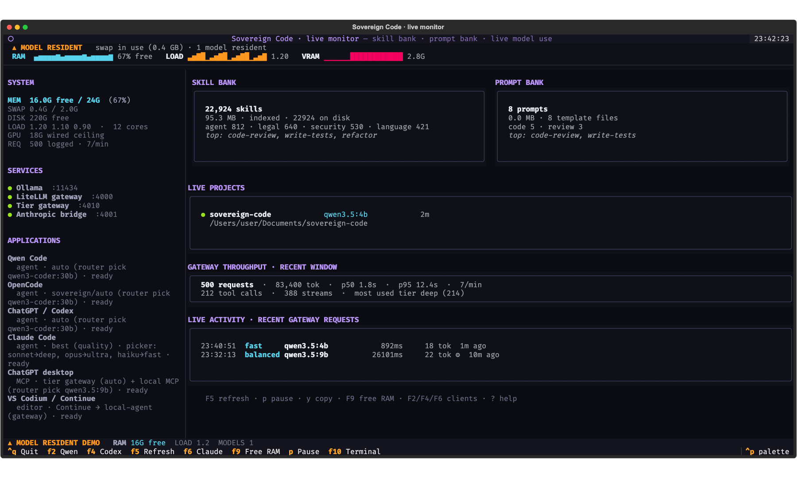
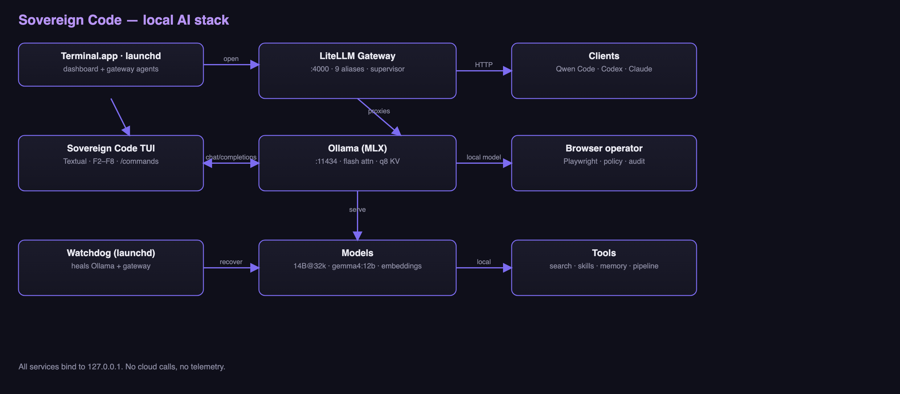
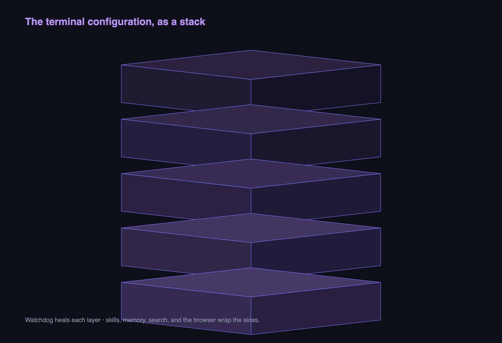

# Sovereign Code

**A terminal-first, local-first AI coding console for Apple Silicon.**

[](https://github.com/ZeroXSHDW/sovereign-code/actions/workflows/ci.yml)
   



## Architecture



The terminal configuration as a 3D stack:



(`docs/assets/social-preview.png` is the 1200×630 image to set as the repository's
social preview card.)

Sovereign Code replaces the Swift menu-bar approach of the earlier Local Bar
projects with a portable Python/Textual system. At login, Terminal opens a live,
read-only monitor: the total skill bank and prompt bank, which project is using
a model now, which models are resident, and what the stack is doing. It never
sends a prompt or keeps a model loaded just to watch the machine. From the
monitor you can still jump straight into Qwen Code in the current repository.

Chat is an explicit opt-in (`sovereign chat`), because every chat turn keeps a
model resident for its `keep_alive` window and that is RAM the monitor exists to
protect.

Nothing leaves the Mac by default. Both Ollama and the LiteLLM gateway are bound
to `127.0.0.1`, and every local alias stays local. Frontier models served by
Ollama Cloud are available as an explicit opt-in (`sovereign cloud`); the router
never selects one on its own.

## Quick start

```sh
cd ~/Documents/sovereign-code
./scripts/bootstrap.sh           # venv, install, PATH link, login agent
sovereign                       # open the dashboard now
```

The first run uses `~/Documents/local-ai/config/sovereign/config.toml` and
`~/Documents/local-ai/data/` (sessions and logs).

Everything the system owns lives in `~/Documents/local-ai`:

```text
~/Documents/local-ai/
├── gateway/     LiteLLM config, venv, supervisor, logs
├── bin/         qwen-local, codex-local, claude-local
├── config/      sovereign/ and codex/ profiles
├── data/        sessions and logs
├── models/      Ollama weights (34 GB; ~/.ollama/models symlinks here)
├── qwen/        Qwen Code state (~/.qwen symlinks here)
└── legacy/      archived pre-migration ai-stack
```

### Monitor keys

| Key | Action |
| --- | --- |
| `F2` | suspend the monitor and open Qwen Code in your workspace (`~/Documents`) |
| `F4` | open the local ChatGPT / Codex profile in your workspace |
| `F5` / `r` | refresh the live report now |
| `F6` | open Claude Code against the local gateway |
| `F9` / `f` | unload every resident model (free RAM) |
| `p` | pause or resume the 5-second refresh |
| `y` | copy the current snapshot to the clipboard |
| `?` | open the help overlay |
| `Ctrl+Q` | quit |

The monitor also shows a health verdict with the reasons behind it, five-minute
sparklines for RAM/load/resident GPU memory, model inventory, and aggregate
gateway throughput (requests, tokens, p50/p95 latency, tool calls, and streams).
The login monitor is read-only: no chat prompt, no slash commands, no model
load, and no background guardian tick. Use `sovereign chat` when you want a
conversation and `sovereign code` when you want the coding agent.

For scripts and screenshots:

```sh
sovereign monitor --json            # one machine-readable report
sovereign monitor --demo            # deterministic UI for screenshots/tests
```

`workspace` lives in `~/Documents/local-ai/config/sovereign/config.toml` and defaults to
`~/Documents`; `sovereign code /path/to/repo` overrides it for one session.

## Why this is better than the old Local Bar build

| Local Bar (Swift) | Sovereign Code |
| --- | --- |
| Pinned to a Swift 6.3 / macOS 26.5 SDK | Plain Python 3.11+; no app build step |
| Menu-bar window, mouse-first | Live terminal dashboard, keyboard-first |
| Hard-coded model/client paths in Swift | One TOML + env config; model catalog in Python |
| No automated tests in the repo | 26 unit/headless-TUI tests, `pytest` |
| Single model pinned at build time | Curated remote catalog with ~35 downloadable tags, model-info, and offline stacks |
| Context fitting spread across UI code | `router.py` estimates KV + weights against free RAM |
| Client setup mutates many apps | Detects clients, writes only its own profile and `*-local` wrappers |
| No session history | JSONL per conversation under `~/Documents/local-ai/data` |
| Session retention | optional: `session_retention_days` / `session_keep` in `config.toml` |

See [docs/IMPROVEMENTS.md](docs/IMPROVEMENTS.md) and
[docs/ARCHITECTURE.md](docs/ARCHITECTURE.md).

## Models (24 GB M5 Pro)

### Installed / recommended

| Model | Role | Notes |
| --- | --- | --- |
| `qwen3.8:27b` | **primary** — code, agent, reason, chat, vision | 18 GB; native vision; 256k native window, **16k** verified at 100% GPU on 24 GB |
| `qwen3-coder:30b` | fast coder (`local-code-fast`) | 19 GB MoE, ~3B active; 32k verified with q8 KV |
| `glm-4.7-flash` | alternate reasoner / thinking | 19 GB; 32k with `think:false`; needs the machine to itself |
| `gpt-oss:20b` | fastest strong tool caller | 13 GB; 16k |
| `qwen2.5-coder:14b` | dense fallback for every alias | 9.0 GB; 32k with q8 KV |
| `gemma4:12b` | independent reviewer (`local-review`) | 7.7 GB; a *different family* from the Qwen implementer, on purpose |
| `qwen3.5:9b` | Claude Code / balanced tier | 7.6 GB; 64k, which Claude Code's tool prompt needs |
| `qwen3.5:4b` | fast tier | 4.0 GB; 8k |
| `nomic-embed-text` | embeddings | 0.3 GB |

`glm4`, `qwen2.5-coder:7b`, and `deepseek-r1:8b` were removed in this pass — superseded by the
27B and no longer referenced by any alias. Run one model at a time: `OLLAMA_MAX_LOADED_MODELS=1`
is set in the launch agent, because keeping a second 18–20 GB model resident only produced
half-spilled runners (13%/87% CPU/GPU) and a reload on every task switch.

### Downloadable (any tag works with `sovereign pull` / `sovereign run`)

`OllamaClient` talks to Ollama directly, so **any** Ollama library tag can be
downloaded and run — not just the curated ones below. Use
`sovereign model-info <tag>` to check parameter size, quantization, family, and
context length before you pull, and `sovereign models --remote [query]` to
browse the curated catalog.

| Model | Rough size | Notes |
| --- | --- | --- |
| `qwen2.5-coder:1.5b` | ~0.9 GB | tiny coder; fast, low RAM |
| `qwen2.5-coder:3b` | ~1.9 GB | small coder; quick edits and iteration |
| `qwen2.5-coder:7b` | ~4.7 GB | solid coder |
| `qwen2.5-coder:14b` | ~9.0 GB | best coder that fits 24 GB |
| `qwen2.5-coder:32b` | ~20 GB | stronger coder; tight on 24 GB |
| `deepseek-coder-v2:16b` | ~9 GB | strong coding model |
| `deepseek-r1:7b` | ~4.4 GB | reasoning with visible chain-of-thought |
| `deepseek-r1:14b` | ~9 GB | reasoning with visible chain-of-thought |
| `deepseek-r1:32b` | ~20 GB | strong reasoning; tight on 24 GB |
| `qwen3:4b` | ~2.3 GB | current-gen general model |
| `qwen3:8b` | ~4.9 GB | current-gen general model with reasoning |
| `qwen3:14b` | ~9 GB | current-gen general model with reasoning |
| `llama3.2:3b` | ~2.0 GB | tiny fast general model |
| `llama3.1:8b` | ~4.9 GB | reasoning fallback with long context |
| `gemma3:12b` | ~7.7 GB | general model with strong reasoning |
| `phi4:14b` | ~9 GB | small reasoning model |
| `codestral:22b` | ~13 GB | Mistral coding model; tight on 24 GB |
| `qwen3.8:27b` | ~18 GB | **primary** local coder/agent, native vision; 256k native ctx, tight on 24 GB |
| `nomic-embed-text` | ~0.3 GB | embeddings for semantic search |

> **Qwen3.8-Flash-Next is not on this list, on purpose.** It is the 125B-A6B
> datacenter sibling of the 27B: the *smallest* published artifact is 105 GB
> (`qwen3.8-flash-next:125b-a6b-nvfp4`, or `:125b-mlx`), the GGUF quants start at
> 120 GB, and OCI requires `H100_X8`/`H200_X4` to serve it. On 24 GB of unified
> memory it can only page off the SSD, so it would be the slowest option here,
> not the fastest. It is deliberately absent from `REMOTE_CATALOG`, so
> `sovereign models --remote` will not offer it — check
> [ollama.com/library/qwen3.8-flash-next](https://ollama.com/library/qwen3.8-flash-next)
> for sizes, because a bare `ollama pull qwen3.8-flash-next` starts a ≥105 GB
> download.

### Frontier cloud models (opt-in — prompts leave the Mac)

These are served by **Ollama Cloud** or a **provider key** (OpenRouter, DeepSeek,
Z.ai, Moonshot, Alibaba), not downloaded. `sovereign cloud` shows the mapping,
the route each alias will use, and readiness. `sovereign cloud --enable` flips
the two switches that disable Ollama Cloud (`~/.ollama/server.json` and
`OLLAMA_NO_CLOUD`), updates the login agent and the sourced shell profile, and
restarts Ollama.

| Requested | Ollama tag | Context | What it is |
| --- | --- | --- | --- |
| Kimi K3 | `kimi-k3:cloud` | 1M | Moonshot, native multimodal agent, 2.8T |
| DeepSeek Flash V4.1 | `deepseek-v4.1-flash:cloud` | 1M | DeepSeek's current fast coding model |
| DeepSeek Flash V4 Pro | `deepseek-v4-pro:cloud` | 1M | 1.6T MoE, frontier reasoning |
| DeepSeek V4 Flash | `deepseek-v4.1-flash:cloud` | 1M | exact V4 Flash with a provider key; V4.1 Flash over Ollama (tag retired 2026-08-27) |
| GLM 5.3 FL | `glm-5.3-flash:cloud` | 1M | Z.ai 320B MoE / 18B active, multimodal |
| GLM 5.2 | `glm-5.2:cloud` | ~976k | Z.ai previous flagship |
| QWEN 3.8 | `qwen3.8:27b` | 256k | **local** 18 GB download; not cloud; primary for code/agent/reason |
| Kimi K2.6 | `kimi-k2.6:cloud` | 256k | Moonshot multimodal agent |

```sh
sovereign cloud                     # status, mapping, and what is ready
sovereign cloud --enable            # enable Ollama Cloud + restart (persists)
ollama signin                       # one-time account login
sovereign cloud --install-aliases   # write cloud-* aliases into the gateway
sovereign pull kimi-k3:cloud        # register a cloud model (no weights)
sovereign run kimi-k3:cloud "…"     # stream a prompt from it
sovereign pull qwen3.8:27b          # the one local model in the list (~18 GB)
```

Gateway aliases (after `--install-aliases` and a gateway restart):
`cloud-kimi-k3`, `cloud-kimi-k2.6`, `cloud-deepseek-v4.1-flash`,
`cloud-deepseek-v4-flash`, `cloud-deepseek-v4-pro`, `cloud-glm-5.3`,
`cloud-glm-5.3-flash`, `cloud-glm-5.2`, `cloud-qwen3.8`, `local-qwen3.8`, plus
the role aliases `local-cloud` and `local-cloud-fast`. Use them anywhere an
alias is accepted:

```sh
sovereign consult "review this design" --models cloud-kimi-k3,cloud-glm-5.3
sovereign bench --models cloud-kimi-k3,cloud-deepseek-v4-pro
sovereign pipeline "…" --plan-model cloud-glm-5.3 --review-model cloud-kimi-k3
```

**Plan requirement.** Ollama Cloud needs an account, and these frontier models
need an **Ollama Pro** plan. The app wires everything correctly, but the
subscription is on the account: on a Free plan every one of them returns HTTP
402 with an upgrade link, which `sovereign cloud --probe` reports as
`needs an Ollama Pro plan`. Qwen 3.8 is the exception because it runs locally.

### Use a provider key instead (no Ollama Pro needed)

One **OpenRouter** key covers all eight models. Direct DeepSeek, Z.ai, Moonshot,
and Alibaba keys also work and are preferred when present (fewer hops, usually
cheaper):

| Provider | Env var | Models |
| --- | --- | --- |
| OpenRouter | `OPENROUTER_API_KEY` | all eight, including exact `deepseek/deepseek-v4-flash` |
| DeepSeek | `DEEPSEEK_API_KEY` | V4.1 Flash, V4 Pro, V4 Flash |
| Z.ai | `ZAI_API_KEY` (or `ZHIPUAI_API_KEY`) | GLM 5.3, 5.3 Flash, 5.2 |
| Moonshot | `MOONSHOT_API_KEY` (or `KIMI_API_KEY`) | Kimi K3, K2.6 |
| Alibaba | `DASHSCOPE_API_KEY` (or `QWEN_API_KEY`) | Qwen 3.8 Max (cloud fallback) |

```sh
sovereign cloud --set-key openrouter     # prompts hidden; writes cloud.env 0600
sovereign run cloud-kimi-k3 "…"          # direct provider call, works immediately
sovereign cloud --install-aliases        # cloud-* now route through OpenRouter
sovereign gateway --restart
sovereign cloud --probe                  # one tiny completion through the chosen route
```

`sovereign run` talks to the provider directly for a provider route, so it
needs no gateway restart. `consult`, `bench`, `summarize`, `pipeline`, and the
client tools use the gateway aliases, which do need `--install-aliases` and a
restart.

Routing is `auto` by default: a configured direct provider key, then OpenRouter,
then Ollama Cloud. Force a route with `--route openrouter` (or `ollama`,
`deepseek`, `zai`, `moonshot`, `dashscope`). `local-qwen3.8` is always local;
`cloud-qwen3.8` uses a provider when one is configured. Keys live in
`~/Documents/local-ai/gateway/cloud.env` (mode 0600), which the gateway
supervisor sources; `sovereign cloud` only shows a masked value.

**Privacy.** A `:cloud` tag sends the prompt, system message, and attached
context to ollama.com; a provider route sends them to that provider (OpenRouter
or the direct vendor). Local aliases and the local router are unchanged.

Every `pull` prints an estimated size and warns when free disk is low, and
`sovereign rm <tag>` reclaims space.

### Offline model stacks

These are rough installed-size totals for a 24 GB Mac; models run one or two
at a time (Ollama swaps automatically).

| Stack | Models | Approx. total | Note |
| --- | --- | --- | --- |
| `lean` | qwen2.5-coder:3b, qwen2.5:0.5b, nomic-embed-text | ~4 GB | fast edits + tiny chat + embeddings |
| `balanced` | qwen2.5-coder:7b, qwen3:4b, deepseek-r1:8b, nomic-embed-text | ~14 GB | solid coder + chat + reasoning |
| `capable` | qwen2.5-coder:14b, gemma4:12b, deepseek-r1:14b, nomic-embed-text | ~29 GB | best local coder + reasoning; swap with `sovereign free` |
| `max` | qwen2.5-coder:32b, deepseek-r1:32b, codestral:22b | ~53 GB | maximum capability; pull only what you need |

Pull a stack one model at a time, or pull a whole stack in one command:

```sh
sovereign pull-stack lean       # ~4 GB: fast edits + tiny chat + embeddings
sovereign pull-stack balanced   # ~14 GB: solid coder + chat + reasoning
sovereign pull-stack capable    # ~29 GB: best coder + deep reasoning
sovereign pull-stack max        # ~53 GB: maximum capability (pull one at a time)
sovereign setup-stack capable   # pull stack, then verify gateway aliases
sovereign pull-stack cloud      # register the 7 cloud tags (no download)
```

The router picks the best **installed** model for the task, then chooses the
largest context that fits in ~85% of free memory. Agentic coding prefers a
model that is verified to call tools (`gemma4:12b`, then `qwen3.5:4b`) rather
than a code model that only chats. The 14B coder reaches 32,768 tokens because
Ollama runs with flash attention and a q8_0 KV cache; without those settings its
verified ceiling is 20,480. The context choices are
`32768, 24576, 20480, 16384, 8192, 4096, 2048`. `sovereign free` evicts resident
models before a turn so a 4B model is not squeezed into a 2k context by a
resident 12B. If the 14B coder is missing it falls back to 7B and says so;
`sovereign pull-recommended` installs it.

## Tier gateway: fast models for small work, big models for hard work

`sovereign router` runs an OpenAI-compatible gateway on `127.0.0.1:4010` in front
of LiteLLM (4000) and Ollama. It classifies each request and sends it to a tier:

| Tier | Model | Context | Used for |
| --- | --- | --- | --- |
| `fast` | `qwen3.5:4b` | 8k | short questions, simple edits, one-line answers |
| `balanced` | `qwen3.5:9b` | 65k | tool use, multi-turn work, medium prompts |
| `deep` | `qwen3-coder:30b` (code) · `glm-4.7-flash` (reasoning) | 32k | code, analysis, long/complex prompts |
| `ultra` | `qwen3.8:27b` | 16k | hardest reasoning, only when explicitly requested |
| `best` | quality-first alias | 32k | 30B coder for code, GLM for reasoning |

Benchmarked on this Mac with the same coding prompt: `qwen3-coder:30b` **12.7 s**,
`glm-4.7-flash` **13.4 s**, `qwen3.8:27b` **45.1 s**. That is why `deep` routes
coding to the 30B MoE and reasoning to GLM, and the dense 27B is now the explicit
`ultra` tier rather than the default for every hard request.

```sh
sovereign router --start        # background gateway
sovereign router --status       # tiers, current models, upstream
sovereign router --stats        # recent request count and average latency
sovereign status                # shows tier gateway online/offline
```

Clients ask for `best` (quality-first) or `auto` (latency-first); named aliases still work. The gateway streams correct
OpenAI tool calls directly from Ollama (LiteLLM's streamed Ollama translation
returns them as text), so OpenCode, Continue, and Qwen can execute tools through
the tier gateway. It also:

- warms the 4B tier at startup so the first small request is not a cold load;
- keeps **one model resident** at a time, evicting the other before a tier
  switch (two 18 GB models panic the Metal allocator on a 24 GB Mac);
- re-loads a model if its resident context is smaller than the tier requires;
- caches short, deterministic, tool-free responses for 10 minutes (`x-sovereign-cached: 1`);
- truncates huge tool outputs, compacts old turns while keeping the task anchor, and
  tells a model to stop when the same tool call repeats three times — so multi-hour
  sessions do not silently overflow the context or loop forever;
- exposes `x-sovereign-tier`, `x-sovereign-model`, and `x-sovereign-reason` headers;
- writes per-request latency to `~/Documents/local-ai/data/logs/tiers.jsonl`.

Measured on this M5 Pro / 24 GB: a cached short answer returned in ~0.1 s, a warm
9B agent turn took ~7–9 s, a 30B code turn took ~12–28 s depending on prompt size,
and the 27B ultra answer took ~21 s once warm. The first request after a tier
switch pays the model load.

**Local-only is enforced by default.** Cloud aliases and provider routes return
HTTP 403 instead of silently leaving the Mac. To allow them deliberately:

```sh
SOVEREIGN_LOCAL_ONLY=0 sovereign router --restart
```

`sovereign local --strict` verifies the gateway is in local-only mode.

Explicit models bypass classification: `local-fast`, `local-chat`, `local-code`,
`local-agent`, `local-claude`, `local-glm`, `local-vision`, … are mapped to their
configured models; `cloud-*` and other upstream aliases are **blocked** in the
default local-only mode. Start the gateway with `SOVEREIGN_LOCAL_ONLY=0` to allow
them to proxy through LiteLLM.

### Client defaults with the tier gateway

- OpenCode: `sovereign/best`, small model `sovereign/balanced` (avoids a model
  swap on every turn), plus the `local/` provider; `openrouter/` is opt-in.
- Continue: `Sovereign Best`, `Auto`, `Deep`, and `Ultra` OpenAI-compatible models.
- Qwen Code: default `best` in its OpenAI provider list.
- ChatGPT (Codex app): `model = "best"` in `~/.codex/config.toml`, pinned to the
  tier gateway's **Responses API** with no OpenAI sign-in.
- Claude Code: the bridge → tier gateway. The default turn follows the quality
  route (`best`); the picker slots are mapped to local routes by the bridge:
  Sonnet → `deep` (30B coder), Opus → `ultra` (27B), Haiku → `fast` (4B). The
  slots carry the model ids Claude Code knows, so it never complains about a
  name it does not recognise.
- Codex: the local profile points at the tier gateway's **Responses API**
  (`/v1/responses`), so it gets the same fast/balanced/deep routing and real
  tool calls. `--cloud` switches to the ChatGPT subscription.
- `sovereign env`: `OPENAI_BASE_URL` is the tier gateway and `OPENAI_MODEL=best`.

### The model catalog: one list, both clients

Both gateways serve the same model list, built from the routing tables and the
models Ollama has installed:

```sh
curl -s http://127.0.0.1:4010/v1/models   # the tier gateway (ChatGPT, Codex, OpenCode)
curl -s http://127.0.0.1:4001/v1/models   # the Anthropic bridge (Claude)
```

The list holds the tiers (`fast`, `balanced`, `deep`, `ultra`), the quality
routes (`auto`, `best`), the local aliases (`local-claude`, `local-glm`,
`local-review`, …) and every installed local model by name. Anything in it can
be asked for: a client that names `qwen3-coder:30b` gets exactly that model.
Cloud and embedding models are not in the list, because the local-only gateway
refuses them and they cannot answer a chat turn.

`sovereign doctor` checks the models every client config points at against that
list, so a config that names a model the gateway cannot route is reported
instead of failing at the first prompt. A request that does not fit the model
the route picked is answered by the 64k 9B instead of being truncated.


### Gateway wiring for ChatGPT / Codex / Claude local clients

`qwen-local`, `codex-local`, and `claude-local` (from `sovereign install-clients`)
and the `sovereign env` exports route those clients through the LiteLLM gateway
aliases (`local-chat`, `local-code`, `local-agent`, `local-claude`,
`local-reasoning`, `local-reasoning-deep`, `local-chat-qwen3`, `local-fast`,
`local-vision`, …). Those aliases are mapped to Ollama models in
`~/Documents/local-ai/gateway/config.yaml`. Use these commands to make sure the
aliases actually point at models you have downloaded:

```sh
sovereign gateway-aliases        # alias → model → installed? → size
sovereign gateway-aliases        # exit code 1 if any alias points to a missing model
sovereign pull qwen2.5-coder:14b gemma4:12b   # pull multiple at once
sovereign setup-stack capable    # pull a stack, then verify all aliases route
```

If an alias shows "no" under Installed, the corresponding client (Codex, Claude,
or ChatGPT via the local profile) will get an empty reply until you `sovereign pull`
that model. All aliases currently route to installed models.

### Real ChatGPT in Codex (opt-in — prompts leave the Mac)

Everything above is local, and Codex's local path talks to Ollama directly
because LiteLLM's *streaming* `/v1/responses` returns a tool call as plain text
instead of a `function_call`, which Codex renders as prose and never executes.

If you want the actual ChatGPT models instead, sign in once and ask for cloud
mode. This bypasses Ollama and the gateway entirely:

```sh
codex login                      # browser; or: codex login --device-auth
codex login --with-api-key       # or pipe an OPENAI_API_KEY instead
sovereign launch codex --cloud   # real ChatGPT; code and diffs go to OpenAI
```

`--cloud` refuses to run until `codex login status` reports a session, and the
launcher prints a warning before it starts. Nothing switches automatically: the
local router never picks a cloud model, so the default stays on-Mac.


## Local coding clients

`sovereign install-clients` is the one-command setup. It writes the Codex
profile and wrappers, configures OpenCode and Continue, registers the
`sovereign` MCP server with Codex (also used by the ChatGPT app), Claude Desktop,
Claude Code, OpenCode, and Qwen Code, and installs the curated skills into every
client.

| Client | Local agent | Verified behaviour | How |
| --- | --- | --- | --- |
| Qwen Code | Yes | writes files, runs commands | `sovereign launch qwen [path]`; `qwen3-coder:30b` |
| Codex CLI | **Yes** | executes `exec_command`, edits files | `sovereign launch codex [path]`; tier gateway `/v1/responses` |
| Claude Code | **Yes** | executes `Write`/`Edit`/`Bash` | `sovereign launch claude [path]`; local Anthropic bridge on `:4001` |
| OpenCode | **Yes** | executes `Write`/`Edit`/`Bash` | `sovereign launch opencode [path]`; custom `local/` provider |
| VS Codium + Continue | chat/edit/autocomplete | chat, inline edit, FIM | `sovereign launch codium [path]` |
| ChatGPT desktop | **Yes**, with `sovereign chatgpt --local` | its Codex side runs on the tier gateway with no OpenAI sign-in | the app's `~/.codex/config.toml` is pinned to `sovereign-tier` |
| Claude Desktop | via MCP | same MCP tools | `claude_desktop_config.json` is pre-wired; restart the app |

> **Why a bridge?** LiteLLM's **streamed** Ollama translation emits tool calls as
> text, which Claude Code prints instead of executing. Codex 0.163 only speaks
> the Responses API. The tier gateway now implements `/v1/responses` with a
> proper event stream (`response.output_item.added`,
> `response.output_text.delta`, `response.function_call_arguments.delta`,
> `response.completed`), so Codex shows text as it is generated and executes
> tools correctly through the same fast/deep router. `sovereign bridge`
> does the equivalent for Claude's Anthropic API and forwards text deltas as
> they arrive, so a long local answer never looks like a stalled connection.
> OpenCode's built-in `ollama` provider is avoided for the same reason; its
> config uses a custom `local/` OpenAI-compatible provider.

```sh
sovereign install-clients         # wrappers + client configs + MCP + skills
sovereign bridge --start          # Claude Code bridge (also auto-started by launch)
sovereign launch claude ~/projects/app
sovereign launch codex ~/projects/app --model glm-4.7-flash
sovereign launch opencode ~/projects/app
sovereign launch codium ~/projects/app

# Real subscriptions (prompts leave the Mac):
sovereign launch codex ~/projects/app --cloud
sovereign launch claude ~/projects/app --cloud
```

`--cloud` for Codex uses the ChatGPT subscription login (`codex login`) and
skips every local override; `--cloud` for Claude uses the Claude subscription.
The local MCP server remains available to both, so the cloud model can call
`sovereign` tools on this Mac.

**Fully local ChatGPT UI.** `sovereign chat-web` serves a self-contained,
loopback-only ChatGPT-style client on `127.0.0.1:4020`: streaming, model picker
(`best`, `auto`, `deep`, `ultra`, `balanced`, `fast`), sessions in local storage,
swift skill search over all 22k skills, and no CDN or telemetry. It is the fully
local alternative to the closed ChatGPT chat window.

```sh
sovereign chat-web --start      # background server
sovereign chat-web --open       # open the browser
sovereign chat-web --install-app # ~/Applications/ChatGPT Local.app
```

The local app calls only `127.0.0.1:4010`; if the gateway is local-only, the UI is
too. It also has a **Browser panel**: enter a URL and a task, and the local 9B
planner drives a visible Chromium window (click/type/scroll/extract/screenshot)
while keeping destructive actions blocked unless confirmed. Use `chatgpt-local`
when you need the full Codex file-editing agent.

**ChatGPT desktop.** The official app cannot run local model weights for its
**chat** pane, but its Codex side can be pointed at the local tier gateway, and
`sovereign chatgpt --local` does exactly that: it pins `~/.codex/config.toml`
to `model_provider = "sovereign-tier"` with `openai_base_url` on
`127.0.0.1:4010`, and the provider needs no OpenAI credentials, so **the app
works with no sign-in at all**. The token comes from a command
(`[model_providers.sovereign-tier.auth]`), not from an environment variable,
because an app launched from Finder or the Dock inherits no shell
environment. `install-clients` also writes the `sovereign` MCP server into
`~/.codex/config.toml`, `~/.mcp.json`, `~/.codex/.mcp.json`, and the ChatGPT
app's `claude_desktop_config.json` discovery path. Restart ChatGPT after
installing; if its Connectors UI does not show it automatically, use the
"Import from Claude Desktop" action (that config is already written). The
server's MCP instructions tell ChatGPT to use `list_models`, `ask`,
`list_skills`, and `run_checks`. `ask` defaults to `auto`, so ChatGPT's quick
questions reach the 4B and hard ones reach the 27B.

**OpenCode.** The default model is `sovereign/auto` with
`sovereign/balanced` for background calls; `opencode run --auto` edits files
through the tier gateway. The `sovereign` MCP server is connected; `local/` and
`openrouter/` providers remain available for explicit choices.

### Sovereign Local menu bar

`sovereign local-bar --install --open` builds **`~/Applications/Sovereign Local.app`**,
a native menu-bar controller with:

- live Ollama/tier-gateway and ChatGPT Local status;
- the tier latency (`fast 804ms · balanced 4373ms · …`), the resident model and
  the free memory, so the menu answers “is it still fast?” at a glance;
- **Open ChatGPT Local**, **Open ChatGPT desktop**, **Start local Codex**,
  **Start local Claude**;
- **Force local ChatGPT (no sign-in)**, **Restore cloud ChatGPT**,
  **Point Claude at local bridge**, **Restore cloud Claude**;
- **Unload resident models**, **Restart local stack**, **Run local-only audit**,
  **Verify ChatGPT is local**;
- `Quit`.

It launches clients with `SOVEREIGN_LOCAL_ONLY=1`, and Ollama itself now runs with
`OLLAMA_NO_CLOUD=1`, so cloud models are disabled at the server and gateway
layers. `sovereign local --strict` checks both.

### Multi-hour local sessions

The gateway is built for long runs: huge tool outputs are truncated, old turns are
compacted while keeping the task anchor, and a repeated identical tool call gets a
stop instruction instead of looping forever. The clients also support their own
session resume:

```sh
claude --continue                 # resume the last Claude Code session
codex resume --last               # resume the last Codex session
opencode --continue               # resume the last OpenCode session
```

Use `best` for quality, `auto` for speed, `deep` for the 30B coder, `ultra` for the
27B, and `balanced` for long-context work. All of them stay local.

### What “local ChatGPT” and “local Claude” mean here

The ChatGPT app's **chat** pane stays a cloud client, but its Codex side can be
pinned to this Mac: `sovereign chatgpt --local` rewrites the app's own config so
every model call goes to the tier gateway and no OpenAI sign-in is needed.
Claude Desktop is the same story for its agent side through `settings.json`.

| Experience | Local model? | How |
| --- | --- | --- |
| `chatgpt-local` | **Yes** — full local Codex agent | `sovereign launch codex`; tier gateway `/v1/responses` |
| `chatgpt-cloud` / `codex-chatgpt` | No — ChatGPT subscription | `codex` with the saved cloud config |
| `sovereign chatgpt --local` | **Yes** — the app itself, no sign-in | `~/.codex/config.toml` → `sovereign-tier` on 4010 |
| `sovereign chatgpt --cloud` | No — ChatGPT subscription | the saved cloud config is put back |
| `sovereign chatgpt --verify` | **Yes** — proves it | live round trip through the app's own provider config |
| `sovereign claude --local` | **Yes** — Claude Code/Cowork | `~/.claude/settings.json` → bridge on 4001 |
| `sovereign claude --cloud` | No — Claude subscription | the saved cloud settings are put back |
| `claude-local` / `claude` | **Yes** — full local Claude Code agent | `~/.claude/settings.json` → bridge on 4001 |
| `claude-cloud` | No — Claude subscription | remove/override the local settings |
| Claude Desktop chat | No — Anthropic cloud | its Codex/Cowork agent follows `settings.json` and MCP |
| ChatGPT desktop chat | No — OpenAI cloud | its Codex side runs local, no sign-in |

```sh
sovereign local --strict      # prove every local agent path is local
sovereign local --fix         # repair local Claude/Codex settings
sovereign chatgpt --local     # force the app onto the tier gateway, no sign-in
sovereign chatgpt --cloud     # put the saved cloud config back
sovereign chatgpt --verify    # prove it: config, sign-in, app-server, live turn
sovereign claude --local      # point Claude Code/Cowork at the local bridge
sovereign claude --cloud      # put the saved cloud settings back
sovereign claude --restart    # launch Claude with local settings/MCP
chatgpt-local                 # full local agent in a project
claude-local                  # full local Claude Code agent
```
`--local` keeps the app's config as it was in `~/.codex/config.toml.sovereign-cloud`,
so `--cloud` gives the app back exactly what it had. The local agent commands are
the honest answer for “work locally with ChatGPT / Claude”; the desktop chat
windows remain cloud clients.

`sovereign launch ... --model` accepts an Ollama tag (`glm-4.7-flash`,
`qwen3.5:9b`) or, for Claude through the bridge, a gateway alias
(`cloud-kimi-k3`, `local-glm`, …). Model selection otherwise uses the router.

### MCP for ChatGPT, Claude Desktop, Codex, Claude Code, OpenCode, Qwen

`sovereign mcp` serves newline-delimited JSON-RPC over stdio. It exposes:

- `list_models` — installed local/cloud models and the gateway route.
- `best_model(task)` — the router's pick and context window.
- `list_skills(query)` / `get_skill(name)` — the curated skill library.
- `project_context(path)` — project memory and file index.
- `ask(prompt, model)` — a completion through the loopback gateway (`best` by default).
- `run_checks(path)` — detect and run the project's own tests.
- `local_status()` — whether this machine is running the local stack only: the
  tier gateway, the Anthropic bridge, Ollama Cloud, and whether the ChatGPT and
  Claude desktop apps are on the local path without a sign-in. The desktop apps
  can check the claim about themselves over their own MCP connection.
- `delegate(prompt, path, write=false)` — run a real local Codex/Claude agent on a
  project; read-only unless `write=true`, bounded by a timeout.
- `browser_open(url)` / `browser_observe()` / `browser_act(...)` /
  `browser_screenshot()` / `browser_close()` — drive the visible local Chromium
  browser: navigate, click, fill, select, press, scroll, extract, and screenshot.
  Destructive actions require `confirm=true`; secrets are refused.

Skills are also exposed as MCP resources and prompts. `sovereign install-clients`
writes the server into Codex (`~/.codex/config.toml`, shared by the ChatGPT
app), Claude Desktop (`claude_desktop_config.json`), Claude Code (`claude mcp`),
OpenCode (`opencode.json`), and Qwen Code. Restart the desktop apps after the
first install.

### Skills in every client

```sh
sovereign skills                              # config prompts + install counts
sovereign skills install --target all         # 40+ curated skills, every client
sovereign skills install --project ~/app      # project-level skills + AGENTS.md/CLAUDE.md/QWEN.md
sovereign skills search react                # search all 22k skill files
sovereign skills install --name <name>       # install a searched skill anywhere
sovereign skills install --all                # the entire 22k-file library (large)
```

Claude, Codex, Qwen, and OpenCode receive `~/.<client>/skills/<name>/SKILL.md`;
Continue receives `~/.continue/prompts/<name>.prompt`. The project install also
writes a shared index into `AGENTS.md`, `CLAUDE.md`, and `QWEN.md` between
markers, so re-running updates it instead of duplicating it.

### Hugging Face Hub

The Hub is available without adding a second model manager. `sovereign hf`
uses the standard Hugging Face token and cache, so logins and downloads are
shared with `hf`, `transformers`, `vllm`, `mlx-lm`, and any other Hub client.

```sh
sovereign hf status                    # token, account, cache, download paths
sovereign hf login                     # hidden prompt; stores the standard 0600 token
pbpaste | sovereign hf login --token-stdin
sovereign hf login --browser           # `hf auth login` OAuth flow

sovereign hf search "qwen coder" --gguf --license apache-2.0 --limit 10
sovereign hf search "ultrachat" --dataset --format parquet --limit 5
sovereign hf info Qwen/Qwen2.5-Coder-7B-Instruct-GGUF --files --readme
sovereign hf info HuggingFaceH4/ultrachat_200k --dataset --files

sovereign hf download Qwen/Qwen2.5-Coder-7B-Instruct-GGUF \
  --include "*Q4_K_M.gguf"
sovereign hf download HuggingFaceH4/ultrachat_200k --dataset \
  --include "data/test_gen-*.parquet"

sovereign hf import Qwen/Qwen2.5-Coder-7B-Instruct-GGUF \
  --include "*Q4_K_M.gguf" --name qwen-coder:7b
sovereign hf remove Qwen/Qwen2.5-Coder-7B-Instruct-GGUF --yes
sovereign hf list                      # models, datasets, and Hub cache
```

Search the Hub for models or datasets with `--dataset`, then narrow results
with `--filter TAG` (repeatable), `--license`, `--language`, `--format`, and
`--pipeline`. `hf info` shows licence, languages, formats, task, base models,
GGUF context, storage, and an optional README; `--json` is available on every
read command.

Downloads are file-selective by default; `--all` is required to take every
file in a repository, and downloads over 20 GB ask for confirmation. The
default destinations are
`~/Documents/local-ai/models/huggingface/<org>--<repo>` for models and
`~/Documents/local-ai/datasets/huggingface/<org>--<repo>` for datasets. Use
`--local-dir` to change it, `--exclude` to omit files, `--max-workers` to tune
parallelism, `--dry-run` to inspect the command, and `--revision` to pin a
branch, tag, or commit.

`sovereign hf import` downloads one GGUF if necessary and registers it with
Ollama using a generated Modelfile; `--context` sets `num_ctx`, and split GGUFs
are rejected because Ollama needs a single file. `sovereign hf remove` deletes
only that repository's local download and Hub cache paths, after showing the
size and asking for confirmation unless `--yes` is passed.

The token is never written to `config.toml` or printed. `HF_TOKEN` takes
precedence over the saved file when it is exported. Gated repositories still
require accepting their licence on the model page. MCP exposes discovery only:
`hf_status`, `search_hf_models`, `hf_model_info`, `search_hf_datasets`,
`hf_dataset_info`, and `list_hf_local`; downloads remain an explicit CLI action.

### Model selection

`sovereign clients` prints the auto-resolved pick per client.
`eval "$(sovereign env)"` exports the loopback OpenAI and Anthropic environment
for any other tool. Codex uses its own Ollama path; Claude Code uses the bridge;
OpenCode and Continue use Ollama directly.

## Commands

```sh
sovereign                  # live read-only monitor (banks, projects, system)
sovereign monitor          # alias for the same monitor
sovereign chat             # opt-in streaming chat dashboard
sovereign status           # one-shot status (--json for scripts and the menu bar)
sovereign models           # installed + recommended, with roles
sovereign cloud            # Ollama Cloud status, mapping, aliases (--enable/--probe/--pull)
sovereign doctor           # checks and concrete fixes
sovereign doctor --fix     # apply the safe fixes automatically
sovereign verify           # tiny completion per core alias (--all for nine)
sovereign bench            # tokens/sec for chosen aliases (--models a,b)
sovereign backup           # tarball of configs + chat data
sovereign summarize FILE   # or --url URL, via the local model
sovereign index .          # embed a directory for semantic search
sovereign search "query"   # find relevant chunks (--path DIR --top N)
sovereign config           # view settings; --get KEY, --set KEY=VALUE
sovereign stats            # disk usage across the stack
sovereign sessions --search "term"   # search chat history
sovereign pull <model1> <model2>   # pull one or more Ollama models by tag
sovereign run <model> "…"          # download (if needed) and run any model on a prompt
sovereign model-info <tag>         # inspect size/context/family before pulling
sovereign pull-stack <name>        # pull an offline stack (lean/balanced/capable/max)
sovereign setup-stack <name>       # pull stack + verify gateway aliases
sovereign gateway-aliases          # show which aliases route to installed models
sovereign rm <model>               # remove an installed model
sovereign models --remote          # list downloadable models (--remote coder)
sovereign hf status                # Hugging Face token, cache, and download paths
sovereign hf search "qwen" --gguf  # search models
sovereign hf search DATA --dataset # search datasets
sovereign hf download ORG/REPO --include "*.gguf"
sovereign hf import ORG/REPO --include "*Q4_K_M.gguf" --name NAME
sovereign hf remove ORG/REPO --yes # remove download + cache paths
sovereign consult "…"      # run one prompt across several models
sovereign skills           # prompt templates + installed counts
sovereign skills install --target all       # SKILL.md in every client
sovereign skills install --project ~/app    # project skills + AGENTS/CLAUDE/QWEN
sovereign skill <name> --prompt "…"
sovereign mcp              # MCP stdio server for desktop clients
sovereign local            # audit every local agent path; --fix / --strict
sovereign local-bar        # macOS menu bar: --install / --open / --status
sovereign chatgpt          # ChatGPT status; --local forces local (no sign-in), --cloud restores, --verify proves it, --repair fixes drift
sovereign claude           # local Claude settings/bridge; --local/--cloud switch, --restart/--fix
sovereign local --json     # the same audit, machine-readable
sovereign bridge --start   # Anthropic bridge for Claude Code
sovereign memory add "note" # per-project memory (show / clear)
sovereign clone <url>      # clone a GitHub repo into ~/Documents/projects
sovereign pipeline "…"     # plan -> implement -> review across models
sovereign free             # unload resident models
sovereign code [path]      # Qwen Code with the verified agent model
sovereign launch qwen|codex|claude|opencode|codium [path] [--model TAG] [--cloud]
chatgpt-local|chatgpt-cloud|claude-local|claude-cloud   # wrappers in ~/.local/bin
sovereign clients          # installed clients and verified capabilities
sovereign gateway          # gateway status, paths, and restart command
sovereign gateway --restart # stop supervisor + LiteLLM, start, wait for health
sovereign router --start   # tier gateway 4010 (auto/fast/balanced/deep)
sovereign router --status  # tiers, models, upstream
sovereign router --stats   # average latency per tier
sovereign logs [gateway|watchdog|dashboard|bridge] [-n 40] [-f]
sovereign sessions         # list stored chats; --prune --days 30 --keep 50
sovereign install-clients  # wrappers + client configs + MCP + skills
sovereign chat --model qwen3.5:4b
sovereign env              # exports for OpenAI-compatible local clients
sovereign pull-recommended # qwen2.5-coder:14b
sovereign browse URL --task "…" # local model drives a visible Chromium
sovereign install-login --start-now
sovereign uninstall-login
```

## Browser operator

```sh
sovereign browse https://example.com --task "find the pricing table and summarize it"
sovereign browse URL --allow-local --headless --max-steps 6
sovereign browse URL --task "…" --screenshots   # save a PNG at each terminal state
sovereign browse URL --task "…" --dry-run   # show the first planned action only
```

The local model drives a visible, persistent Chromium profile through Playwright,
reading the page and performing one structured action at a time (`navigate`,
`click`, `fill`, `select`, `press`, `scroll`, `extract`), then hands back control
when it needs you. Run it from the CLI with `sovereign browse <url> --task "…"`.

- **No CAPTCHA solving, bot-check bypass, user-agent spoofing, or fingerprint
  evasion.** The browser runs with its normal identity.
- **Passwords, OTPs, and payment fields are never filled by the model** — it
  hands off so you type them.
- **Destructive actions** (buy, delete, submit, unsubscribe, …) ask first unless
  you pass `--yes`.
- **Local/private addresses** need `--allow-local`; `--allow-domain` restricts
  navigation. Every step is recorded (fills are length-only) under
  `~/Documents/local-ai/data/browser/runs/`.

Install: `pip install -e '.[browser]' && playwright install chromium`.

## Skills, memory, and multi-model

Saved prompt templates live in `~/Documents/local-ai/config/skills/` as Markdown
files — `code-review`, `write-tests`, `refactor`, `explain`, `specify`,
`security-review`, `financial-analysis`, and `legal-review`. `sovereign skills`
lists them; `sovereign skill <name> --prompt "…"` runs one through the local
model. Add your own by dropping a Markdown file with a `{{prompt}}` placeholder.

```sh
sovereign consult "what is the best way to X?" --models local-chat,local-reasoning
sovereign skill code-review --prompt "$(cat src/app.py)"
```

`sovereign consult` runs one prompt through several models and prints each
answer.

`sovereign run <model> "…"` downloads the model on first use and runs a prompt
through it directly (any Ollama tag, with `--context`, `--temperature`, and
`--system`). `sovereign models --remote [query]` lists curated downloadable
models, and `sovereign rm <model>` removes one you no longer need.

### Multi-model pipeline

```sh
sovereign pipeline "build a CLI that greets a name" --dir ~/projects/demo --yes
sovereign pipeline "…" --plan-model local-reasoning --agent gemma4:12b --review-model local-agent
```

`sovereign pipeline` chains three models into one coding pass: a **planner**
writes an implementation plan, **Qwen Code** (with the agent model) writes the
files, and a **reviewer** critiques the result. `--yes` auto-approves the agent's
tool calls for unattended runs; `--no-review` skips the final stage. This is the
local version of end-to-end, multi-model coding — one or two models resident at
a time, swapped automatically by Ollama. `sovereign memory add "…"` stores a per-folder note that is injected
into every chat session, so project preferences persist. If a project has an
`AGENTS.md` or `CLAUDE.md`, that too is injected into `sovereign chat`, `sovereign
code`, and `sovereign pipeline` automatically. `sovereign clone
<url>` bootstraps a GitHub repo under `~/Documents/projects/` (then
`sovereign index` it for search).

Honest limits: this is a 24 GB Mac. Models run one or two at a time (Ollama
swaps automatically), MLX is already active for supported models, and "more
speed" comes from model and context choice — not from any of these commands.

## Semantic code search

```sh
sovereign index .                # embed the current directory
sovereign search "gateway restart" --top 5
sovereign search "query" --path ~/repo
```

`sovereign index` walks a directory (skipping `.git`, `node_modules`, venvs, and
binaries), chunks each text file, and stores local embeddings from Ollama's
`nomic-embed-text` (274 MB, pulled automatically via `ollama pull
nomic-embed-text`). `sovereign search` ranks chunks by cosine similarity against
the query. Everything stays on the machine; the index lives under
`~/Documents/local-ai/data/index/` and is excluded from backups and Time Machine
(it is cheap to rebuild).

## Login terminal

`sovereign install-login` writes
`~/Library/LaunchAgents/com.user.sovereign-code.plist`. At login it runs:

```sh
/usr/bin/open -a Terminal /Users/user/Documents/sovereign-code/bin/sovereign-dashboard.command
```

The `.command` starts the dashboard in the project venv. Install is idempotent;
`--start-now` loads the agent immediately so you can see the terminal before
logging out. `uninstall-login` removes it.

### Autostart, keep-alive and reboot

`sovereign autostart --install` turns the three pieces the clients need into
launchd services. Each one starts at login, so the stack is back after a reboot,
and launchd restarts it when it dies:

| Service | What it is | Port |
|---|---|---|
| `com.user.sovereign.gateway` | the LiteLLM gateway | 4000 |
| `com.user.sovereign.tier` | the tier gateway | 4010 |
| `com.user.sovereign.bridge` | the Anthropic bridge for Claude | 4001 |

The always-on `webchat` and `guardian` jobs are gone. They kept a chat server
and a 30-second restart loop running 24/7 without serving a request; the
dashboard is now a passive monitor and `sovereign chat` / `sovereign chat-web`
are started only when you ask for them. Upgrading with `--install` stops and
removes the old plists, so they do not come back at login.

```sh
sovereign autostart              # what survives a reboot, right now
sovereign autostart --install    # install the three services and retire the old two
sovereign autostart --restart    # restart every service
sovereign autostart --repair     # rewrite the plists and reload the jobs
sovereign autostart --uninstall  # remove them and put the old jobs back
```

`sovereign guardian` remains available as a one-shot check of the gateway and
bridge. It is no longer installed as a 24/7 loop; pass `--watch` if you want to
run that loop in the foreground yourself.

The ChatGPT app is local from the first launch after a reboot, because
`launchctl setenv` publishes `CODEX_APP_SERVER_OPENAI_BASE_URL` and
`SOVEREIGN_API_KEY` to the login session and an app opened from the Dock
inherits them.

#### Why the services look the way they do (macOS TCC)

macOS protects `~/Documents`, and `launchd` is stricter than a shell:

- A job may **read** a file there and may **run a program by its full path**,
  but it may not **execute a script** there and it may not **list** a
  directory there. The gateway is therefore started through its interpreter
  (`venv/bin/python3 venv/bin/litellm`), not through `run_gateway.sh`.
- A job may not open a **log file another app created**: such a file carries
  `com.apple.provenance`, and the job then fails to spawn with `EX_CONFIG`
  instead of starting. Every service therefore uses a log file of its own,
  created by launchd itself.

The two Terminal-based jobs that used to start and watch the gateway are
retired by `--install`; their plists are kept as `.superseded` and
`--uninstall` puts them back.

### Gateway autostart (the old way)

`com.user.ailocalgateway.plist` used to run:

```sh
/usr/bin/open -gj -a Terminal ~/Documents/local-ai/gateway/start_gateway.command
```

That hidden Terminal window detached `run_gateway.sh` with `nohup` and exited;
the supervisor restarted LiteLLM on crash and kept Documents access even after
the window closed. It is retired now — `sovereign autostart --install` owns the
gateway — but the files are still there if you want them back.

## Architecture

```text
Terminal / login agent
        │
        ▼
  Textual monitor ─────────────────┐
        │                          │
        ├── Banks ──────────► skills/ + prompts.db + skills_index.db (read-only)
        ├── Live projects ─► running agents + session cwd/model
        ├── OllamaClient ──► 127.0.0.1:11434  (/api/tags, /api/ps)
        ├── Gateway check ─► 127.0.0.1:4000   (/v1/models)
        ├── Router ────────► model + context from free RAM
        └── Clients ───────► Qwen Code / OpenCode (agent), Codex / Claude (chat)
```

## Development

```sh
python3 -m venv .venv
.venv/bin/pip install -e '.[dev]'
.venv/bin/python -m pytest -q
./bin/sovereign status
```

## Security

- Ollama and LiteLLM bind to loopback only; `sovereign doctor` fails if not.
- `OLLAMA_NO_CLOUD=1` is the default. `sovereign cloud --enable` is an explicit
  opt-in; it updates `~/.ollama/server.json`, the session env, and the login
  agent, then restarts Ollama. `sovereign cloud --disable` restores local-only.
- Session files are mode `0600`; no telemetry is sent anywhere.
- `sovereign code --yolo` is explicitly opt-in; the default asks before edits.

## Lineage

Built from the ideas in `~/Downloads/local-bar-main` and
`~/Downloads/local-bar-dev-main`: one resident coder, memory-aware context,
local-only clients, and a readiness check. This project keeps those ideas and
drops the Swift/SDK coupling and menu-bar-only workflow.
